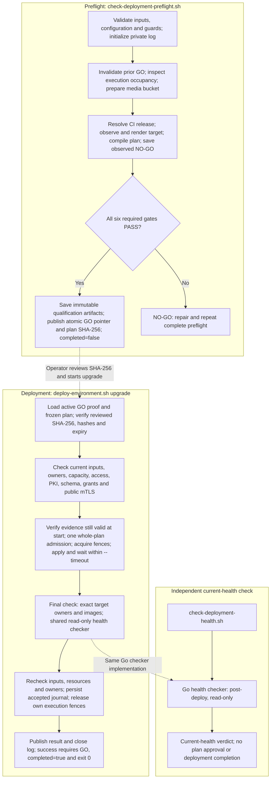

# RTK Cloud Deployment Operations Guide

Status: active

Owner: `rtk_cloud_workspace`

Last reviewed: 2026-10-20

Audience: internal deployment operators and new maintainers

The public deployment workflow covers existing-environment updates and explicitly
selected new-environment creation, including continuation of an interrupted
create. Both qualify the selected target before execution and require final
runtime acceptance. See the [current script delivery scope](deployment-readiness-standard.md#current-script-delivery-scope),
[create instructions](#create-a-new-environment) and
[staged continuation](#create-and-resume-as-one-staged-program). The operator
authorizes live checks and deployment. Production custody, backup/restore and
activation retain their separate qualification requirements.

The deployment wrapper builds and runs the native CLI so exit codes 0/1/2 are
preserved, including when called outside the workspace. Its temporary directory
contains compiler output only and is removed on exit; environment credentials,
reports and operational data use the canonical environment store. After exact
target-image/owner rollout verification, deployment reuses the maintained
read-only health checker for runtime Secrets, PKI, workloads, configured provider
reads and required public CertIssuer mTLS. A failed or incomplete required check
leaves deployment incomplete; Ready Pods alone do not establish completion.

This document is the deployment entry point for internal operators. It covers
creating a new environment, taking over an existing environment from another
controller, and accepting an existing deployment. Linode staging uses only
LKE/Kubernetes; the legacy VM runtime is not an active deployment path.

Complete-environment GO/NO-GO is defined by the accepted
[Unified Deployment Readiness Standard](deployment-readiness-standard.md).
The public plan/preflight/upgrade entries select the shared v2 engine and report
`scope=existing-environment-update` for routine updates. All six required update
gates must pass; Production activation and restore qualification are separate
operations. Explicit create uses the qualified identity lifecycle and staged
recovery described below. Legacy schema-1 preparation
and complete provision entries are retired. The narrower image-only and current
health checks do not replace complete qualification. No production activation
qualification has been completed by these documentation/code changes.

## Current script flow

This is the current implementation for a complete **existing-environment
upgrade**, using the default preflight operation and `deploy-environment.sh
upgrade`. Fresh bootstrap, Production activation, scoped `image-upgrade` and
business E2E/data acceptance have separate procedures. The workflow below does
not establish that any environment has passed its live checks.

| Entry | Dispatch and responsibility |
| --- | --- |
| [`check-deployment-preflight.sh`](../scripts/check-deployment-preflight.sh) | Calls [`check-deployment-credentials.sh`](../scripts/check-deployment-credentials.sh) with fixed `pre-deploy`/read-only settings. `deployment check` dispatches the complete update to the shared v2 `preflight` CLI. Qualifies one exact plan and publishes immutable proof plus an atomic GO/NO-GO pointer. |
| [`deploy-environment.sh upgrade`](../scripts/deploy-environment.sh) | Builds and runs the native `deployment upgrade` CLI. Loads the approved proof and frozen plan, verifies evidence validity before execution starts and current execution conditions, executes its resources within `--timeout`, and runs mandatory final verification and health acceptance before reporting completion. |
| [`check-deployment-health.sh`](../scripts/check-deployment-health.sh) | Uses the common check wrapper with fixed `post-deploy`/read-only settings. Checks the current environment independently; it does not approve a future plan or finish an earlier deployment. |

The **final check is inside deployment**. The executor first verifies the exact
target workload owners and images, then `acceptEnvironmentRollout` directly
calls the maintained Go health checker with `--phase post-deploy --read-only`.
It does not launch `check-deployment-health.sh` as a child script. The standalone
health wrapper remains useful for later rechecks and diagnosis.

### Flow chart

Solid arrows show the successful execution path. Dotted arrows show the
operator's evidence handoff or shared implementation, not automatic shell
invocations. Required failures stop the affected path; the failure behavior is
described below.



### Ordered checks and completion boundary

Preflight performs these steps:

1. Validate invocation, maintained configuration, report path and
   maintenance/recovery guards, then initialize the private progress log.
2. Create this invocation's generation token and replace the active qualification
   pointer and earlier GO bindings with NO-GO before new checks. A short private
   publication lock guards all observation and final authorization writes;
   an older invocation cannot overwrite a later generation. Inspect the local
   `deployment/.execution-active` fence, then the selected cluster Lease.
   Occupied or unreadable state stops before storage preparation and compilation.
3. Verify the configured media bucket. When
   `RUNTIME_MEDIA_STORAGE_CUTOVER_REQUIRED=false`, confirmed absence permits
   creation of that exact bucket and requires fresh inventory readback.
4. Resolve exact-source formal CI images, observe selected live owners and
   identity references, render the maintained target and compile the v2 plan in
   memory. Save compiled observations as NO-GO bindings.
5. Run the six required gates in order: `deployment.target`,
   `deployment.release`, `deployment.execution`, `deployment.pki`,
   `deployment.compatibility`, `deployment.network`. Only complete PASS evidence
   permits immutable qualification artifacts and GO bindings. Publish the atomic
   active GO pointer only after those private files are complete. Report the plan
   SHA-256 and qualification validity, with
   `completed=false` because preflight has not deployed anything.

Deployment repeats input validation, also requiring `--confirm` and the reviewed
`--plan-sha256`. It loads the exact immutable plan, release, bindings and proof
named by the active GO pointer and verifies their hashes, checker/policy identity,
generation, environment, operation and expiry. Binding-only GO evidence from an older
version requires one new complete preflight. There is no search for another
receipt or reuse of an invalidated pointer.
Proofs issued before the validity/timeout split require one new complete
preflight because the checker and maintained configuration have changed.

Deployment consumes the proven immutable release, rendered candidate and
isolated startup qualification. It does not resolve CI images, render the target
or run the six full qualification gates again. After evidence admission, it
checks current configuration/credentials/source and cluster identity, resource
owners/storage, capacity, permissions, execution occupancy, native PKI and schema
prerequisites. The five immediate check groups are target, execution, PKI,
compatibility and network. They retain original PKI PVC mode/owner inspection,
current OTA authorization/revocation and private storage read grants, original
media allocation/privacy, and authenticated public CertIssuer mTLS/anonymous
denial. These checks still perform provider/database reads and native probes.
All approved preflight and immediate probes, including the public mTLS helper,
use the frozen Kubernetes API/CA and credentials. `Plan.Execute` performs whole-plan admission once before acquiring
the cluster Lease and local execution locks and saving the full plan and initial
journal. Resource writes and waits follow phase/dependency order. Each phase
has fresh input/resource fences; each write has fresh owner/baseline checks and
exact-body admission.

Qualification validity begins when complete preflight succeeds, so qualification
itself does not consume the proof's reuse window. Expiry is that time plus
`DEPLOYMENT_PREFLIGHT_VALIDITY_SECONDS` (shared baseline: 3600 seconds). Deployment
checks validity when loading the proof and again at execution admission, before
the immediate checks begin. Once admitted, the attempt follows the caller's
`--timeout`; reaching proof expiry
does not shorten its deadline. Phase/input fences still reject replaced or
invalidated proof and changed inputs, source revisions or ownership. Every new
attempt must be admitted while its evidence remains valid.

For example, evidence expiring at 14:02 may admit a deployment at 14:00 with
`--timeout 90m`. That attempt may run until its CLI deadline without stopping at
14:02. A new attempt starting at or after 14:02 is blocked. Expired proof,
future-dated qualification and missing original PKI evidence have distinct
causes. Evidence timing diagnostics print `qualified_at`, `valid_until` and
`checked_at` in UTC.

Earlier PKI check times and cutoffs remain provenance, rather than being refreshed
by proof publication. Deployment obtains current registry/revocation evidence and
checks certificates and CRLs through the later of its execution deadline or the
current time plus `DEPLOYMENT_UPGRADE_WINDOW_SECONDS`, the maintained minimum PKI
margin. That margin does not impose an execution timer. The CLI starts its
`--timeout` deadline before loading evidence; it covers that loading, immediate
checks, admission, ownership acquisition, writes, rollout and final acceptance
without resetting at admission. Ownership cleanup retains its separate bounded
budget.

After the resource loop, completion requires resource verification, exact
target owner/image checks, the read-only health checker, another input fence and
resource verification, final UID/Lease ownership checks, and the accepted
journal. The executor must then release its own cluster Lease and archive its
local execution fence before the CLI can report `completed=true`. The integrated
health checker covers current credentials and Secret mirrors, workloads, live
PKI, configured provider reads and required public CertIssuer mTLS. Full feature,
business-flow and data acceptance remain separately invoked tests.

A failed, cancelled or timed-out execution still attempts ownership-checked
cleanup under a fresh bounded context. Cleanup failure is NO-GO and retains
unreleased evidence for inspection. Partial writes or failed health acceptance
remain incomplete even when cleanup succeeds; there is no automatic rollback
or journal continuation. Inspect the journal, resolve the actual failure and
repeat complete preflight for a newly reviewed plan.

An unchanged target may compile to an already accepted plan SHA-256. When every
resource in that identical plan is `retain` and the original journal records
complete accepted ownership, deployment can revalidate the current target with
valid complete preflight proof. It consumes that proof and repeats immediate checks,
admission, input and owner fences, exclusive execution ownership, resource
verification and the integrated health acceptance. It performs no resource
writes and preserves the original
`plan.json` and `journal.json`. Each successful revalidation records separate
private verification at `deployment/recovery/revalidated-<unique>/verification.json`; completion still
requires confirmed ownership cleanup, with the owner archived under the original
plan's `execution-owner-*/owner/` directory. Cleanup failure remains NO-GO even
when the verification receipt exists. An unaccepted or partial journal, a
plan containing any non-`retain` action, or changed owners remains NO-GO and
requires a separately qualified plan or recovery. Progress identifies this
revalidation as `deployment.execution.recovery`, separately from Lease acquisition.

Invalid invocation, configuration, guard or log initialization can fail before
old GO invalidation. GO bindings are published before the optional report, and
logs close last; report/log publication failures still fail the command. Check
the exit status together with the final verdict rather than treating a stored
GO record or an accepted journal as proof that the entire command succeeded.

Preflight's optional report uses `rtk-cloud.deployment-report/v2` with a sanitized
plan summary (`schema_version: 2`) and, when available, `qualification_sha256`, `qualified_at`,
`evidence_valid_until` and `reused_preflight`. Admitted deployment reports also
record `execution_admitted_at` and `execution_deadline`, separately from the
evidence timestamps. Gate rows identify their
`evidence_source` as `preflight` or `execution`; failed current checks preserve
their native blocker in `check_id`.
Full private qualification artifacts live at
`deployment/preflight/<plan-sha256>/qualification-<unique>/`: `proof.json`,
`plan.json`, `release.json` and `bindings.json`. The atomic
`deployment/preflight/active.json` uses `rtk-cloud.preflight-active/v1` and points
to the exact qualified attempt and proof hash. `proof.json` uses
`rtk-cloud.preflight-proof/v1`; both carry the invocation generation. NO-GO
invalidation prevents reuse of earlier artifacts without deleting them. Final
GO publication compares that generation under `deployment/preflight/.publication.lock`,
publishes matching bindings and commits the active pointer last. Cancellation,
expiry or commit failure revokes only its own generation. The immutable proof
binds the complete gate results and native response digests, frozen inputs,
checker/policy identity, selected cluster/Kubernetes identity and exact formal CI
artifact provenance. Formal manifest bytes remain private; raw probe responses
and diagnostics are not observation/report payloads.
Generated bindings use `rtk-cloud.preflight-bindings/v1` at
`deployment/identity-bindings.json`. Execution saves the full `plan.json` and
`journal.json` under `deployment/rollback/<plan-sha256>/`; accepted all-`retain`
revalidation writes a separate
`deployment/recovery/revalidated-<unique>/verification.json`. All these paths are
beneath `~/.config/rtk_cloud/<environment>/`, with 0700 directories and 0600 files;
see [artifact paths](deployment-secrets-governance.md#configuration-versus-deployment-generated-data).

Implementation evidence: [`runDeploymentCheckWithDependencies`](../scripts/go/rtk-cloud/deployment_check.go)
owns phase dispatch; [`runUnifiedEnvironmentDeploymentWithDependencies` and
`acceptEnvironmentRollout`](../scripts/go/rtk-cloud/deployment_unified_cli.go)
own qualification/publication and integrated health;
[`Plan.Execute`](../scripts/go/rtk-cloud/internal/deploymentplan/execute.go)
owns admission, writes, final verification, journaling and fence cleanup.

## Select the Operation First

| Scenario | Correct entry point | Modifies cloud resources? |
| --- | --- | --- |
| Check tracked configuration | `deployment plan --operation upgrade` | No |
| Check an existing-workload image upgrade | `scripts/check-deployment-preflight.sh --environment NAME --operation image-upgrade --manifest PLAN.json --image GHCR_DIGEST` | No cloud writes; validates exact candidate, CI, schema, startup and retained identity/configuration |
| Check whether the desired deployment can proceed | `scripts/check-deployment-preflight.sh --environment NAME` | Only the documented missing-media-bucket preparation; remaining provider probes are read-only |
| Check the health of an existing deployment | `scripts/check-deployment-health.sh --environment NAME` | No; read-only live environment checks |
| Create a new environment | `deployment plan --operation create` -> complete preflight -> `deployment create --plan-sha256 SHA256` | Provision does |
| Upgrade persistent staging | Reviewed plan and CI image provenance -> `deployment upgrade` (or a scoped existing-workload rollout) | Updates selected resources; never implies reset |
| Check Console release features | `deployment console-check --environment NAME --cloud-id UUID --product-id UUID --test-account-id UUID` | Uses an existing Test Lab account; creates private login sessions, otherwise GET/HEAD only |
| Take over an existing environment | Transfer matching controller state and SecretStore -> complete preflight and current health check | Preflight does not |
| Prepare or migrate Object Storage | [Storage policy](object-storage-policy.md) and [storage operations](storage-credential-lifecycle.md) | Only explicitly selected bootstrap/migration/cutover steps |
| Restore core data after deployment | [Matched backup/restore procedure](backup-restore.md) under a maintenance/write fence | Explicit restore replaces selected datasets after a safety backup |
| Reconcile an execution fence left by a controller crash or failed cleanup | `deployment reconcile-execution --environment NAME --plan-sha256 ORIGINAL_SHA --confirm video-cloud-NAME` on the original controller | Releases only verified original execution fences; archives receipts without resource rollback. Partial writes or uncertain acceptance require separately qualified recovery. Repeat complete preflight afterward. |
| Import original storage completion evidence | `deployment storage-import-state --environment NAME --purpose media\|ota --source-runtime ORIGINAL_RUNTIME --confirm STACK` | Writes validated original evidence to the canonical environment directory; never changes cloud resources or generates a new completion time. See [storage evidence migration](storage-credential-lifecycle.md#environment-owned-receipts-and-proof-location). |
| Schedule online PostgreSQL backups | [Daily PostgreSQL procedure](postgres-backup-restore.md) and isolated restore qualification | Creates dedicated backup resources; production scheduling requires measured evidence |
| Accept an existing environment | `deployment acceptance` | Creates or updates test data; does not rebuild the deployment |
| One-time environment rehearsal | `deployment test` | Creates resources and removes the owned resources at the end |
| Remove an environment | `deployment remove` | Deletes resources owned by that stack |

Deterministically resolved, secret-free configuration is located at:

```text
cloud_env/<environment>/runtime
```

Neither `cloud_env/staging/lke` nor `cloud_env/staging/linode` is an active input.
Do not copy, rename, or symlink a legacy path into the runtime. For an existing
environment, transfer matching controller state and separately recover its
SecretStore. Core data restoration uses the explicit recovery procedure, not a
recursive controller-directory copy.

## Information Required Before Deployment

### Accounts and Permissions

- Git read access to the workspace and every private submodule.
- Linode account access and a `LINODE_TOKEN` allowed to create LKE, VMs, firewalls,
  VPCs, volumes, and Object Storage resources.
- The active-service limit confirmed by the Linode account owner. The Linode API
  cannot report this value; do not guess it.
- GHCR `read:packages` permission to pull the image for each pinned service commit.
- Record-mutation permission for the environment's selected DNS provider;
  staging defaults to GoDaddy.
- An SSH key pair for temporary load-generator VMs.

### Controller Tools

A fresh controller requires at least Git, Go, `kubectl`, Helm, `certbot`, `curl`,
`jq`, OpenSSL, and SSH. Load tests additionally require Ansible. Docker is needed
only for local image operations.

Initialize the complete checkout first:

```sh
git submodule update --init --recursive
```

### Environment SecretStore

All sensitive data is centralized under `~/.config/rtk_cloud/<environment>/`.
Each operator key is a separate mode `0600` file under `operator/env/`. Normal
deployment does not read process environment variables, shared profiles,
workspace runtime secrets, or legacy home env files.

The main current items for LKE + GoDaddy staging are:

```env
LINODE_TOKEN=<redacted>
GHCR_PULL_USERNAME=<github-user>
GHCR_PULL_TOKEN=<redacted>
GODADDY_KEY=<redacted>
GODADDY_SECRET=<redacted>
```

Manage them with `rtk-cloud secrets init|plan|migrate|verify|inventory`. Secrets
may exist only in the environment SecretStore, K8s runtime mirror, or GitHub
Actions Secrets. Never write them into tracked environment configuration, PRs,
issues, chat messages, or test reports.

PayPal hosted top-ups remain disabled until the selected environment has
`operator/env/PAYPAL_ENABLED` set to `true` and the three mode `0600` files
`runtime/paypal-client-id`, `runtime/paypal-client-secret`, and
`runtime/paypal-webhook-id`. Set `operator/env/PAYPAL_ENVIRONMENT` to
`sandbox` for development; the deployment rejects production PayPal for a
`-dev` stack. The Billing runtime manifest reads these files from that
environment's SecretStore and derives fixed HTTPS return and cancel URLs from
the Billing domain, plus the Cloud Admin origin for the after-return URL.
Billing appends the owner-scoped Billing activity path after PayPal redirects back.
Before enabling checkout, verify that the PayPal webhook ID belongs to the
same environment, points to
`https://<billing-domain>/v1/payment-webhooks/paypal`, and subscribes to
`PAYMENT.CAPTURE.COMPLETED`. A targeted Billing rollout must update the
Billing server before its payment worker so the new migration is applied first.

The shared dependency check and renderer resolve these flags from the same
selected configuration and canonical operator store. Explicit `false` values
for `PAYPAL_ENABLED`, `NEWEBPAY_ENABLED` and `PAYMENT_SIMULATOR_ENABLED` take
precedence over Test Lab defaults. If every provider is disabled, the payment
worker has zero replicas; the Billing API still must become ready. Enabling
PayPal with incomplete canonical credentials fails before workload execution.
For an already interrupted immutable workload, preserve its original snapshot
before changing selected inputs and use the documented bounded continuation;
patching the live Secret alone does not update the saved target.

### Tracked Environment and Ignored Runtime

| Location | Content | May be committed? |
| --- | --- | --- |
| `cloud_env/<env>/environment.env` | Stack, DNS root, logical location, public OAuth settings and explicit Test Lab intent | Yes; never client secrets |
| `cloud_env/<env>/deployment.env` | Architecture, deployment adapter, DNS adapter | Yes |
| `cloud_env/<env>/overrides/*.env` | Reviewed environment differences | Yes |
| `cloud_env/<env>/runtime/` | Deterministic secret-free resolved configuration only | No |
| `~/.config/rtk_cloud/<env>/deployment/adapters/lke/account.env` | Operator-confirmed active-service limit | No |
| `~/.config/rtk_cloud/<env>/deployment/adapters/lke/state.env` | Environment/stack-bound original cluster and node-pool IDs | No |

For an existing Kubernetes workload update, both preflight and deployment select
the cluster through the canonical kubeconfig and check live ownership, access,
node capacity, storage and exact admission. Local Linode `state.env` and
`account.env` are not required, read or included in the update input hash.
Their absence, obsolete content or provider-quota changes cannot block that scope.
Infrastructure creation/node-pool changes remain separate provider operations;
those operations retain their provider identity and account-quota requirements.
Historical unused provider metadata can be preserved as unverified source bytes
under `migration-backup/provider-state/<source-sha256>/` before removing old
copies and quota fields from generated legacy configuration. Such an archive is
not active provider state, successful ownership migration or GO evidence.

Maintain the confirmed quota in the selected private environment store. Use
`0700` directories and a `0600` `account.env`; the only allowed assignment is
`LKE_ACTIVE_SERVICE_LIMIT`. Existing legacy provider state is migrated explicitly:

```sh
./scripts/deploy-environment.sh provider-import-state \
  --environment staging \
  --source-runtime /absolute/original/cloud_env/staging/runtime \
  --confirm video-cloud-staging
```

Use the actual limit confirmed by the Linode account owner. Use the literal `unlimited` only when the account owner confirms there
is no active-service cap. The live inventory and projected resource count are
still queried and reported.

## Complete Preflight

Complete preflight derives the entire target in memory from maintained settings,
live observed lifecycle references and an immutable formal release. It does not require
or discover a private workload-spec plan. Preflight reads the successful exact-source `image-manifest.json` artifacts
directly from each service's formal CI Release workflow. It builds the image
selection in memory from the current workspace HEAD and its service gitlinks.
No local release file is read or written. Provider image versions belong in
maintained architecture/environment settings; registry lookup pins configured
version tags to digests. `deployment plan` prints a sanitized plan, not GO.

After validating invocation/target configuration and maintenance/recovery
guards, preflight invalidates previous GO and checks the selected environment's
canonical `deployment/.execution-active` fence, then, for upgrades, its cluster
execution Lease.
An occupied or unreadable fence/Lease stops with early NO-GO before media-bucket
preparation, formal CI image resolution, target compilation or the six gates;
there is no qualified plan or other PASS result. This guard reads occupancy only:
it never acquires/deletes a Lease or performs Lease create dry-run. The execution
gate repeats its fresh occupancy and admission checks later to catch races.
The guard applies to preflight; formal CI resolution still precedes inventory
and target compilation for attempts that pass it.

The preflight wrapper defaults to a complete upgrade of an existing Kubernetes
environment. A missing canonical kubeconfig blocks this path; it does not prove
that the provider cluster is absent. Verify the selected cluster and operation,
and restore the original kubeconfig only if that cluster still exists. After
removal, do not revive its archived cluster identity or automatically change an
upgrade into creation. Select `--operation create` for fresh qualification:
the startup guard checks the local execution fence first, then uses only the
selected canonical provider credentials and recorded ID or maintained label for
fresh, complete read-only Linode discovery. Exact stack tags also fence renamed
owners. It does not require a kubeconfig or cluster Lease for an absent target.
Existing clusters, inaccessible/mismatched recorded IDs, retained original volumes
and incomplete inventory remain BLOCKED. Confirmed absence proceeds through
formal CI release resolution and the shared staged create qualification described
in [Create a New Environment](#create-a-new-environment).
Present but unreadable, non-private or invalid kubeconfig files remain separate
fail-closed diagnostics and require the original selected identity and access to
be verified.

```sh
go run ./scripts/go/rtk-cloud -- deployment plan \
  --environment staging --operation upgrade
scripts/check-deployment-preflight.sh \
  --environment staging \
  --report "$HOME/.config/rtk_cloud/staging/deployment/reports/staging-preflight.json"
```

Review the reported plan SHA-256. Every required gate must PASS; FAIL, ERROR,
BLOCKED, SKIPPED or missing evidence means NO-GO. Pre-deploy rejects `--fast`
for every operation. The report includes stable gate IDs, cause, repair, impact and
recheck instructions, without desired Secret values or private baseline specs.
English output uses exit codes 0 (selected operation passed), 1 (NO-GO/check
failure), 2 (invalid invocation/configuration).

Both preflight and deployment print each running stage as a two-line block:
status, stable stage ID and progress fields on the first line, followed by the
task description indented by two spaces. The description has no `task=` prefix
or quotes and is cyan on interactive color terminals. Redirected output,
`NO_COLOR` and private logs retain the same layout without colors.
A stage starts once within its validation round;
unchanged reports of that same stage do not print another start line. Updates
still show changed resource, query-count and rollout-readiness details, and the
10-second `still running` heartbeat confirms that long work remains active.
Qualification identifies `round=preflight` for the initial checks. Deployment
uses qualified preflight evidence and displays immediate execution prerequisite
checks as `deployment.execution.recheck.*`; it does not repeat complete qualification.
Both keep their required evidence and failure outcomes.
Release progress names the consuming role, including `mqtt-pki` and
`openbao-pki`, and the actual subaction: checkout/pin checks, image pull and OCI
labels, CI/Release run inventories, publication jobs, Release run details,
artifact listing and artifact download. For example,
`deployment.release.verify.video-cloud-api.artifact-list` and
`deployment.release.verify.video-cloud-api.artifact-download` identify distinct
requests. Progress labeling does not remove source, publication, admission or
ownership checks. Interactive terminals default to a continuously
updated colored inline progress bar and spinner with current
task/resource/readiness details. The bar/percentage applies only to actual known
admission-check or resource-operation totals; unknown totals show a spinner
without an invented percentage. Redirected output or `TERM=dumb` uses plain
10-second heartbeat lines. Heartbeats show safe resource/action
targets, finished queries and the active query count, with up to three active
targets plus a remaining count. During deployment they also identify the current
resource and apply/dry-run/wait step; rollout shows observed ready/updated counts
and its configured waiting limit. Kubernetes permission queries include their
recognized verb, such as `get` or `patch`, so checks for different permissions on
one resource remain distinct. Counts describe actual work and are not an
overall percentage, PASS evidence or deployment completion. Active work and the
reporter finish and join, and the inline line is finished/cleared before failure
diagnostics, final GO/NO-GO and report output. Successful gates, release-selection substeps
and resource operations do not print `[OK]` lines on the screen; their results
remain in private logs and JSON evidence. `[FAIL]`, `[BLOCKED]` and `[ERROR]`
display in red. Redirected output and `NO_COLOR` omit colors; JSON evidence
retains its original `PASS` status. Invalid release evidence finishes the active
step as `[FAIL]` even when a query succeeds. Execution reports running
qualification, admission, ownership acquisition, phase fences/apply, rollout
waits, verification and acceptance. Failures and cancellation finish the active
phase as `[FAIL]`. Deployment completion still
requires final acceptance, owner verification, journal persistence and cleanup.
Those final owner, journal and lock-release steps each have their own progress
and a recorded outcome; successful cleanup does not turn a failed deployment into success.
Elapsed times, per-query durations and acceptance-check timing are written only
to the private per-attempt `deployment/logs/<action>-<UTC-time>-<unique-id>.log`
under the selected environment store. The CLI creates a new log for each attempt,
including failures, with 0700 directories and a 0600 file. Logs include sanitized
progress and the final report, without terminal animation, credentials, resource
bodies, command arguments or raw subprocess output. User output keeps current
tasks, real progress counts, failures and the final verdict without successful
step lines or elapsed-time diagnostics.

Structured diagnostic measurements are saved alongside progress logs as
`deployment/logs/metrics-<UTC-time>-<unique-id>.log` (JSON Lines). They cover
preparation, gate start/end, duration in milliseconds, each instrumented probe,
query attempts and Kubernetes read-cache hits. A retry counts as another query;
a cache hit does not. Query counts describe commands/requests at the instrumented
boundary: Kubernetes commands, native PKI HTTP, provider HTTP and formal release
Git/GitHub/Docker commands. They do not count API calls hidden inside kubectl
watching, credential helpers or Docker/gh internals. Zero means no instrumented
attempt in that scope, not proof that no uninstrumented work occurred. Gate counts
include nested probes; do not add overlapping parent and child durations/counts.
These diagnostics contain no arguments, cache keys/values or raw error text and
do not change plan/qualification evidence hashes.

Recovery verification obtains a fresh Kubernetes inventory at each validation
boundary, then checks accepted resource UIDs, desired bodies, bound PVCs,
workload readiness and actual Pod image evidence from that snapshot. It does
not wait serially on already accepted resources. Within one invocation, exact
CI artifact archive IDs and immutable image labels may be reused; source HEAD,
workflow/run state, artifact availability/expiry and live state remain fresh.
Metrics distinguish immutable-content cache hits and include DNS HTTP attempts.

An interrupted Device bootstrap Job that never created a Pod because its
ServiceAccount was missing requires the original pending Root UUID, terminal
owned Job and absent native issuer/signer. The create recovery checker qualifies
a separate forward Job with an explicit ServiceAccount dependency. Deployment
retains the failed Job and completes its checkpoint only after the actual
forward stage is accepted; it does not replace the original Root intent or
OpenBao/Service PKI identity.

An interrupted `device-root-trust` rollout with an allocated native receipt is
separate from absent-issuer Device bootstrap recovery. Public create preflight
selects this continuation only for the exact original READY Root, admitted
ready-order forward stage, four completed configuration resources, failed owned
broker and originally unwritten API. It authenticates the accepted Job's actual
operation result and compares all registry issuer/operation UUIDs against native
and reservation receipts, instead of assuming a previous registry count. The
original OpenBao signer must retain its registered Root certificate, actual
provider issuer/key UUIDs and certificate/CRL signing usage; a mount name alone
is insufficient. Original Service credentials, resource bodies and UIDs remain
required. It never replays Root generation. Its original READY ceremony document
is verified and reused; fresh and ACTIVE ceremony records remain exclusive.
An admission-only interruption retains and authenticates each completed
admission's qualified artifact and exact source-journal prefix. A later owned
broker-only forward failure additionally requires the actual stage-bound plan
and native journal: four retained configuration owners, completed Controller,
written broker, originally unwritten API, and no uncertain write. Candidate and
actual bodies must match; only their named-stage binding differs. The latest
written bodies/UIDs supersede earlier bodies for live checks. Earlier pending
trust stages are completed only by receipts referring to the newly accepted
forward stage.

For the original create checkpoint after every managed CA ceremony is ACTIVE,
public create preflight selects `all-ca-active-managed-transport`. It authenticates
the original accepted Device/App trust stages and existing issuer publications,
then qualifies managed transport enrollment without replaying CA ceremonies or
completed client enrollment. An expired incomplete bootstrap session is renewed
only with its original key/CSR and qualified native repair image; all existing
workload client certificate/CSR hashes are verified before and after. Subsequent
runtime owners submit their own genuine installation ACKs.

A later owned MQTT rollout interruption selects
`managed-transports-partial-rollout` through the same complete public create
preflight. The recovery authenticates its original admission/source prefix,
completed same-key session renewal and transport issuer/server stages, all
retained client identities, and the exact failed managed-host child. Original
bootstrap key/CSR pins are resolved through the recorded Service server-stage
alias and its admitted custody artifact; the newer client-preservation proof
must match those same original pins. A historical artifact from another
material domain cannot substitute for that custody evidence. Required
MQTT configuration/runtime producers and explicit database/worker bindings must
be qualified before the corrected broker is admitted. The five-resource forward
contains `mqtt-pki-config`, `mqtt-pki-runtime` and the three original managed-host
objects. It consumes original runtime credentials, the existing
`pki-verifier-database/url` binding, and the existing worker EMQX API pair; it
does not generate credentials. Transport startup retains the native broker
trust-only mode until finalization enables `pkibroker watch` and its managed
HTTPS callback. Execution applies only that reviewed forward, records its actual
accepted stage in the original pending managed-host receipt, then resumes normal
bootstrap completion. It preserves
written owners/PVCs and the originally unwritten OpenBao StatefulSet; it never
replays a completed seed, enrollment or CA ceremony. Missing mounts/producer
bindings remain a deployment prerequisite failure.

An interrupted admitted forward instead selects
`managed-transports-interrupted-forward`. It authenticates the prior six-gate GO,
its exact source prefix/admission and failed five-resource child, including the
genuine new ConfigMap/Secret UIDs and originally unwritten OpenBao baseline.
Its seven-resource repair updates existing owners only: the Controller consumer
policy, the secrets-namespace Service trust manifest and the two managed host
policies, retaining all three earlier configuration objects. Controller policy
readiness precedes both hosts through explicit dependencies. Native current-seed
ACK requires the real Service CRL consumer; static TLS trust cannot substitute.
The final runtime and CRL waits retain the same nine genuine Service consumer IDs.
Only a genuinely accepted new forward can complete both earlier pending parent
aliases. Original failed child journals remain unchanged; no seed, identity or
completed enrollment is replayed.

If that admitted seven-resource forward completes its first six resources but
OpenBao's original StatefulSet write stops with a never-started image-pull
failure, `managed-transports-written-openbao` authenticates both preceding
admissions, source prefixes, child journals and all seven current owners. Its
candidate retains the six completed bodies and changes only OpenBao's reference
to the existing accepted namespace registry Secret. Configuration, image digests,
all six original PVC/PV/CSI identities, native seed and enrolled keys remain
pinned. Original initialization/audit/role receipts qualify the interrupted
host's retained prerequisites; unavailable native audit/authentication readback
is explicitly required after restoration. Existing UID/resourceVersion guarded
OnDelete replacement uses the original unseal share. Actual initialized/unsealed
status, redacted audit device, current seed policy/role and complete signer-role
readback must succeed before historical pending aliases close or normal
completion proceeds. Native commands use the authenticated serving container's
CA projection for bootstrap or managed transport. Offline evidence never
substitutes for final native readback.

If that written-host repair was genuinely accepted and original-share unseal
completed, while post-restoration audit verification stopped before the prior
aliases closed, `managed-transports-accepted-openbao-audit` authenticates its
accepted seven-owner child, exact source/admission/lease suffix and native
unseal intent. It retains six resources and restores only the exact original
redacted audit clause in the original `openbao-file` ConfigMap. Qualification
requires actual Ready/unsealed provider state and an authenticated empty audit
list, plus original token/share, keys, volumes and current session role proofs.
It pins the current provider process by exact executable, UID, command line,
start time and digest. The historical malformed PID-file marker is observation
evidence, never signal authority. After exact ConfigMap readback and projected
HCL hash verification, native OpenBao2.5 SIGHUP reloads the declarative audit
configuration on that same provider process. The sidecar renewal handler is
not used. Real redacted audit and authentication readback must succeed before
older pending aliases close. The already accepted host child is never replayed.
The shared launcher PID producer and native OpenBao installed-client bootstrap
ACK lifecycle remain separately required runtime corrections when affected;
audit restoration alone cannot prove full environment acceptance.

When that audit repair and all original aliases are complete, but the first API
serving export stops after genuine server enrollment and custody acceptance,
`managed-transports-complete-api-export` authenticates the exact completed
source/admission/lease suffix, audit signal/readback and accepted API Job/reader
children. Its seven current transport resources are observations only. It requires
actual Ready/unsealed native audit/authentication, the original shares/keys/volumes,
and the exact Deployment/ReplicaSet/Pod/PVC reader chain. Reuse accepted enrollment
and custody; never rerun their Jobs, host replacement, audit signal or seed renewal.
Export the existing registered server material and continue normal acceptance.
The valid Kubernetes List envelope is parsed separately from the exact owned Pod
count and UID checks. The original generation remains fenced through completion.

If the exact next admitted export succeeded but its reader retirement stopped
before any Kubernetes child/lease was admitted,
`managed-transports-api-export-retirement` authenticates the prior completed
source and new admission/export/pending-retire suffix. It pins the same original
reader/PVC/Pod/ReplicaSet and registered certificate. Read-only re-export must
match the completed intent and receipt; never rewrite them. The explicitly
qualified pending retirement retains its original UID intent and executes through
the planner's `retirement` phase with guarded deletion and native absence proof.
No enrollment, reader recreation or key generation is permitted.

If both original API server exports/reader retirements and serving Secrets
completed but final application startup refused a CRL projection,
`managed-application-partial-rollout` authenticates the exact admitted source,
all six accepted child receipts, both registered server certificates/keys, and the
26-resource partial child:22 completed resources, written original API, and three
untouched original workload baselines. The scoped candidate retains those22 and
updates only the four original workloads. API/Log CRL aliases move to sibling
paths with their manifest references; canonical ConfigMap roles/data, root/bundle
paths, images, private identity claims and security settings stay authenticated.
Current volume-ledger metadata is legitimate deployment output; bind original
per-volume custody digests and genuine newly allocated claim/PV/CSI owners rather
than requiring or fabricating a historical whole-ledger snapshot. Qualify through
the complete public six-gate preflight, execute its exact retained checker, and
close the original pending alias only after genuine forward acceptance. Completed
CA ceremonies, seed renewal, enrollment, exports and reader retirement are never
replayed. Normal routing, issuer ACKs, finalization and full environment health
acceptance still follow.

If that admitted application forward is interrupted after recording the same
API write, its empty failure marker remains unchanged.
`managed-application-interrupted-forward` authenticates the exact original source,
GO admission, twenty-six-resource candidate/child and two-entry/one-lease suffix.
Current bodies use that written recipe; original allocation/export authority still
uses the original child. A missing native API CRL reference is repaired by adding
only `VIDEO_CLOUD_CONTROLLER_SERVER_CRL_MANIFEST` for each API's existing read-only
public ConfigMap file. The native constructor consumes this base field separately
from identity/renewal fields. Historical candidate validation uses its actual old
recipe; later configuration fixes never reinterpret an immutable accepted plan.
This no-enrollment bounded45m continuation requires50m remaining original-session
life. It never renews a seed, recreates an identity, or rewrites a historical child
failure marker. An owned Lease left by the stopped executor may be released only
after qualifying the captured UID/holder/plan and exclusive original local owner,
using fresh UID/resourceVersion delete preconditions and durable native absence
proof. A clock expiry alone never authorizes Lease deletion. Close preceding
pending aliases only after genuinely accepted forward execution.

If the next genuine forward completed the main API and failed at App PKI API
configuration validation, the same `managed-application-interrupted-forward`
profile qualifies the explicit App-role recovery schema. It authenticates the
bounded chain of both admitted predecessors, including the completed prior
Lease release. Its latest child requires23 completed resources,24 owners and the
actual App PKI failure marker. Retain those23 resources and update only App PKI,
Device PKI and LogIngester. The App owner sets
`VIDEO_CLOUD_AUTH_PRODUCT_PKI_REQUIRE_CRLS=false` because this flag belongs to
Device PKI; Device retains `true`. App direct mTLS and its existing
`VIDEO_CLOUD_AUTH_CRL_MANIFEST` still enforce App CRLs. Validate the actual native
configuration and preserve all original public/private trust files, images,
identity claims and allocation owners. A qualified absent Lease needs no release
attempt; a completed historical release never authorizes deleting a later Lease.
Use fresh full six-gate GO and close every authenticated predecessor alias only
after actual forward acceptance. The same50m original-session minimum applies.

For the actual next App trust-file failure, the bounded three-admission
continuation authenticates the 23-retain/3-update failed child and all four pending
aliases. Reuse `projectIncomingBootstrapManifest` for both PKI APIs; the native
reader requires a regular public JSON file, while ConfigMap AtomicWriter exposes
whole-volume files as symlinks. Preserve the original bundle key/content and its
revision-triggered rollout. The same qualified scope may include the explicitly
selected formal `LKE_OPENBAO_PKI_IMAGE` installed-ACK repair: one original
StatefulSet update changes only its two native role references and PID token,
retaining the provider image, original initialized store, unseal share, HCL,
keys/CSRs/certificates and volume owners. Actual original-share replacement,
numeric provider PID, audit/authentication and unchanged registry lineage are
required. The declared executor is bounded30m with fixed25m original-session
prerequisite and an enforced20m native bootstrap phase; a separate15m native ACK/finalization phase requires20m remaining.
Neither phase may renew or replace the session. Publish a durable role proof only
after the accepted role/application children and nine genuine native ACKs, then
complete the same original finalizer and full environment acceptance.

The later failed `managed-complete-issuer` child has a distinct
`managed-complete-issuer-partial-forward` qualification. Authenticate the original
coupled admission, captured source journal, accepted OpenBao/application/routing
children and the exact partial 16-resource core child. Preserve every original
UID and baseline. Its `restore-core-only` action retains 14 resources and updates
the original Controller plus the unwritten CertIssuer; only the Controller's
`PKI_FIXED_DEVICE_ROOT_TRUST` field changes from `false` to `true`, retaining the
same registered Device Root ID and fingerprint. Native Controller configuration
rejects explicit `false`. An expired original session with eight genuine ACKs
and missing `service:video-cloud-logingester` authorizes this core restoration
only. It never authorizes enrollment, renewal, finalization, credential cleanup,
full-target deployment or release of the original parent fence. The scoped result
reports `restoration_completed=true` and `completed=false` after accepted native
readback. A fresh complete six-gate GO with the same checker is mandatory.

A stopped local recovery admission is retained as provenance. The scoped loader
requires its exact six-GO artifact, captured stopped source, original owner,
checker, candidate and unchanged intent, with the admission start inside the
original qualification window. A fresh qualification may reconcile that
pending admission only after genuine native initialization, audit and
session-authentication readback. The receipt uses that admission's original
review and the actual retained audit digest; its original intent and start time
are preserved. Native readback precedes a new local admission, so a refused read
does not append another ambiguous pending entry. Closing this local admission
is not evidence of a Kubernetes forward, identity creation or environment
completion, and never extends the old GO window.

A later interrupted core forward has its own
`managed-complete-issuer-interrupted-certissuer-forward` qualification. Its source
must authenticate the earlier six-GO admission and the genuine stopped child:
14 completed resources, 15 original owner receipts, a completed fixed-trust
Controller, and the already-written failed CertIssuer. Preserve that Controller
and every other completed resource. The fresh candidate retains 15 resources
and changes only the original CertIssuer container to an independently selected
formal API image under the `LKE_CERTISSUER_IMAGE` role. This alias does not change
the original `LKE_VIDEO_CLOUD_IMAGE` application release. The native repair
prepares real managed provider trust before the first OpenBao login when local
CRL preparation fails; valid installed local trust retains deferred offline
startup. Failed synchronization closes the transport before authentication.

Both the original failed core alias and the interrupted forward are reconciled
only after the new child is genuinely accepted. Each receipt binds its own
original failed plan/journal to that actual accepted forward; neither stopped
child becomes accepted retroactively. A durable CertIssuer role completion
requires accepted native UID/body readback, the exact six-GO source and formal CI
publication, and an immutable actual final-journal snapshot. Subsequent target
rendering and health checks consume that proof so they preserve the repaired
CertIssuer image. The core restoration still leaves the parent fenced and the
original expired eight-ACK session unchanged.

LogIngester's ordinary settings adapter in the original business image omits the
global `PKI_BOOTSTRAP_SESSION_ID`, despite the correct Pod environment, and can
remain Ready without sending its session installation ACK. The native store
rejects any previously unrecorded ACK after session expiry; idempotent repeats of
already recorded ACKs do not complete that missing subject. Preserve the expired
session and its real eight-ACK history. Any further same-key/CSR, distinct-session
recovery requires a separate qualified late checkpoint and genuine original-owner
ACKs; it cannot rewrite the original session's identity, expiry or receipts.

A genuinely expired Service Root CRL must be refreshed before restarting its
managed consumers. At this completed-CA checkpoint,
`deployment recover-create-service-root-crl --environment dev
--parent-plan-sha256 <original-parent>` qualifies the original offline authority,
complete live revocations, signed monotonic successor, native import dry run and
exact original consumers. Execute the freshly qualified review with the same
compiled checker, `--execute --review-sha256 <review> --confirm video-cloud-dev`.
The scoped native dev recovery importer and actual native state installation
provide completion evidence. Retain the original initial CRL file/receipt;
subsequent rendering consumes the authenticated successor proof. This scoped
repair GO remains separate from the complete create preflight/acceptance.

If native import and the original Secret update completed but installation
recording stopped, first inspect the exact original journal and native state.
`deployment recover-create-service-root-crl-installed --environment dev
--parent-plan-sha256 <original-parent> --original-review-sha256 <original-crl-review>`
qualifies only a pinned partial repair whose signed successor is genuinely
published and already present on all four original consumer state paths.
Use its exact compiled checker and fresh `--execute --review-sha256 <resume-review>
--confirm video-cloud-dev` to record verified completion. This path never replays
signing/import, updates a Secret or state file, restarts a workload, or claims a
runtime ACK. Preserve original qualification, admission and receipts; consume
the explicit authenticated installed-resume completion pointer.

Expired temporary TLS at that checkpoint uses a separately scoped repair:
`deployment recover-create-active-transports --environment dev
--parent-plan-sha256 <original-parent> --candidate <canonical-candidate-dir>`.
The default operation qualifies its exact original owners, ACTIVE issuers,
same-key certificates and native dry-run requests. Execution requires that exact
fresh `--review-sha256`, `--execute`, and `--confirm video-cloud-dev`, using the
same compiled checker. Its GO qualifies only this certificate repair; rerun the
formal complete create preflight afterward. Original V1 proof, authority and
serving keys, managed Roots and OpenBao initialization remain preserved. The
native executor verifies projected hashes, reloads the existing OpenBao process,
and restarts the two original provider consumers to load the reviewed public
trust. A currently valid Service Root CRL is a restart prerequisite.

After the broker's application Service enrollment, its native managed transport
must fetch and acknowledge Service CRLs. The Controller's initial core consumer
policy is expanded with this selected broker before Device/App consumers start;
mTLS, registered identity, CRL and native acknowledgment checks remain in force.
The broker's registry consumers also require `PKI_BROKER_MANAGEMENT_CA` pointing
to the already mounted original Service trust `/run/pki-service/root.pem`;
managed outbound HTTP trust does not replace this explicit public-CA input.
Native broker Root-policy and CRL locks/atomic writes also use its own PVC root.
The maintained Device recipe supplies a pinned `broker-trust-permissions` init
container that binds the original `mqtt-pki-trust` claim and existing private
client state. It reuses the directory-only preparation contract: reject symlink
or ambiguous paths, hash the existing client record, set only the PVC root's
owner/mode to 10001:10001/0700, then verify unchanged client bytes. It never
recursively changes keys/files, widens them through fsGroup, or copies identity.
Actual initializer completion and native consumer ACK remain deployment checks.
The native incoming Device/App admission reader requires a regular public JSON
manifest. These API recipes therefore bind only `bundles.json` from the original
owned trust ConfigMap through a read-only single-key subPath volume at
`/run/pki-<domain>-manifest/bundles.json`; Kubernetes' ordinary directory
projection exposes a symlink and does not satisfy that native file contract.
The CA bytes, ConfigMap UID and original registered bundle stay unchanged; no
private credential is copied. App bundle revision annotations restart the owner
when its admitted intermediate manifest changes. A completed broker plus a
written failed API is a distinct supported forward boundary: all six completed
owners and the seventh written API UID/body must agree with the admitted stage,
with no in-flight/uncertain write. Recovery keeps that UID and completes earlier
pending stages only after a genuinely accepted new forward.
The qualified trust forward plan retains the completed ConfigMap/Secrets,
updates only this Controller policy, preserves the written broker owner and
creates the original unwritten API. Its Deployment dependency requires the
Controller rollout to finish first. Original trust completion is recorded only
from the actually accepted forward stage; actual consumer acknowledgments still
precede Device activation. Subsequent managed-host recipes retain the expanded
policy. An expired seed is a distinct original-key renewal qualification, never
permission to replace its key, Root or recorded expiry.

The first App Root trust rollout follows completed Device activation. Its
continuation requires the actual ACTIVE Device document and accepted native Job,
unchanged READY offline App Root and original request/custody hashes, five
completed configuration owners, failed written broker and unwritten App API.
The broker must explicitly enable `PKI_BROKER_APP_PKI_ENABLED=true` alongside
App manifest/bundle acknowledgment settings. Qualification reconstructs the
original recipe and isolates only that missing enforcement flag. It retains
completed Device/transport/enrollment stages, never reruns either Root ceremony,
and records original App trust completion only after the accepted forward.
All native consumer acknowledgments still precede App Root activation.

Recovery timeout is an actual execution bound. Temporary transport authorities
must cover that bound plus the unchanged 15-minute qualification margin at every
required check. Selecting a shorter bound does not extend a certificate or
remove signature/identity/expiry checks; if the remaining operation cannot fit,
its separate qualified transport lifecycle or managed transition is required.

An interrupted original create at `pki-reserve-openbao_tls-intermediate` is
selected automatically by `--operation create`. Its recovery qualifies the
admitted source, completed enrollment/trust stages, original active OpenBao TLS
Root and CRL, and the exact five existing issuers/operations before correcting a
refused DNS request. Managed OpenBao DNS policy preserves the seven dotted
aliases; the bare `openbao` search-path alias belongs to temporary transport and
is excluded from the native managed intermediate policy. The original rejected
request intent remains in its journal; a separately qualified forward request
records the real returned operation. Completed Root activation/CRL publication
is reused without replacement. A genuinely expired bootstrap leaf is renewed
through the original key/CSR lifecycle using the qualified formal image and 8h
TTL, while OpenBao credentials, offline custody and registered Roots are retained.

## Existing Pod image upgrade: GO / NO-GO

For an update of existing Pods with current features and configuration retained,
use the existing checker with `--operation image-upgrade`. This scope is distinct
from default full-deployment rendering, feature activation and data acceptance.
The default legacy renderer's managed-PKI refusal does not qualify or prohibit
this separately checked image-only path.

GO requires all selected immutable images to pass authenticated full amd64 pulls,
match the selected source checkouts, and have successful exact-source main CI
and formal `Publish LKE image` jobs. Supply every selected RTK container/sidecar
image and every existing consumer of each selected package (APIs, workers and
auxiliary executables), with complete candidate Deployment JSON using repeatable `--image` and
`--manifest` flags (a Kubernetes List is supported). Each candidate must have an
existing configuration/rollback owner, and its nonimage spec must match the live
spec. Changes to identity, mounts, environment, PVCs, ports or feature flags
require their separately reviewed configuration/migration operation. Retained
ServiceAccount-token projections are checked for UID/fsGroup file read access;
projected Secret/configuration sources still require separate effective-access
qualification.

The check additionally requires applied candidate AM/Billing migration versions,
all current environment Deployments/StatefulSets/DaemonSets and their application
Pods to be Ready at their current generation (OnDelete StatefulSets require
Ready owned Pods at the declared container/init images rather than an automatic
rollout revision), and the required public CertIssuer
route plus actual client mTLS and anonymous TLS denial. Pending/failed CI,
unapplied migrations, incomplete inventories or failed startup/PKI checks mean
NO-GO. Post-deploy with the same operation
also requires every selected Pod-template image to equal the candidate.

For a selected payment simulator, the effective configuration must disable
startup migration. The checker executes its **published artifact** in an isolated
local Docker fixture with schema CREATE denied, then requires its health endpoint
to return HTTP 200 from inside the isolated network; no host port is exposed. The fixture uses no environment data or credentials, is private to the
invocation and is removed after success or failure. Cleanup failure prevents GO.
These image-upgrade checks read cloud state; Docker pulls and disposable local
fixtures change local Docker state. Docker and GitHub CLI authentication are
required. Schema reads use the existing LKE PostgreSQL operator access. Current
live PKI checks cover installed PKI schema/identity prerequisites; this operation
does not replace a separately required PKI schema migration qualification.

```sh
# Use the selected release checkout and reviewed environment-private plan.
# Repeat both flags for all affected workloads and package digests.
scripts/check-deployment-preflight.sh --environment staging \
  --operation image-upgrade --checks ghcr,mounts \
  --manifest "$HOME/.config/rtk_cloud/staging/deployment-readiness-candidates/current/plan.json" \
  --image "$RELEASE_IMAGE" --report "$HOME/.config/rtk_cloud/staging/deployment/reports/staging-image-upgrade.json"
# After the authorized rollout, require the same exact candidate images:
scripts/check-deployment-health.sh --environment staging \
  --operation image-upgrade --checks ghcr,mounts \
  --manifest "$HOME/.config/rtk_cloud/staging/deployment-readiness-candidates/current/plan.json" \
  --image "$RELEASE_IMAGE" --report "$HOME/.config/rtk_cloud/staging/deployment/reports/staging-image-upgrade-health.json"
```

Keep plans containing runtime configuration private (0700 directories/0600 files)
in the selected environment's SecretStore. Read each result's scope and selected
candidate set. GO applies to updating those existing Pod images with retained
settings. Disabled feature activation and full business/data qualification remain
separate results; they do not become image-upgrade blockers simply because their
features have not been enabled. A prerequisite pass cannot predict every future
application defect; recheck exact images and required service behavior after rollout.

## Deployment Phase Checks

Choose the check for the deployment phase. Each shell entry prints its purpose
and when to use it before building or contacting external systems:

Deployment already includes the required final health check in the
[current script flow](#current-script-flow). The standalone post-deploy command
below is an independent recheck, not a missing completion step.

```sh
# Before an existing-environment update: run complete preflight qualification.
scripts/check-deployment-preflight.sh --environment staging \
  --report "$HOME/.config/rtk_cloud/staging/deployment/reports/staging-pre-deploy-check.json"
# Independent recheck after deployment: Secret mirrors, live PKI and routing.
scripts/check-deployment-health.sh --environment staging --fast \
  --report "$HOME/.config/rtk_cloud/staging/deployment/reports/staging-post-deploy-check.json"
# Direct Go entry points:
go run ./scripts/go/rtk-cloud -- deployment check --phase pre-deploy --environment staging
go run ./scripts/go/rtk-cloud -- deployment check --phase post-deploy --environment staging --fast
# Scoped pull evidence; this is not complete release GO:
go run ./scripts/go/rtk-cloud -- deployment credentials-check --environment staging \
  --read-only --checks ghcr --image "$RELEASE_IMAGE"
```

The shell builds the checker once and preserves its 0/1/2 exit status.
Health is read-only. Preflight checks and creates a missing configured media
bucket when `RUNTIME_MEDIA_STORAGE_CUTOVER_REQUIRED=false`; other provider
probes remain read-only. Creation is followed by fresh inventory verification.
It does not migrate objects, replace credentials or fabricate cutover evidence. Complete preflight uses the same compiler and
resource bodies as create/upgrade; no schema-1 file selects a different renderer.
Existing-environment upgrades use the same six update gates for dev, staging and
prod, as defined in [the readiness standard](deployment-readiness-standard.md).
Fresh bootstrap and Production activation are separate operations. Missing update
evidence blocks execution.

Use `deployment credentials-check` for a scoped provider/image/TLS check; full
preflight does not accept `--checks`, ad hoc `--image` or `--manifest` inputs in
place of the selected release. Use `--operation image-upgrade` only for the
separately described narrower existing-consumer update.
Post-deploy health still checks the existing runtime. Its PASS is health evidence,
not complete release/plan acceptance or permission to initialize identities.
The legacy credentials script defaults to post-deploy provider canaries; use the
named health entry for routine read-only inspection.

| Mode | Provider writes and receipts | Explicit `--image` |
| --- | --- | --- |
| Legacy/direct post-deploy default | Selected DNS/storage canaries and validation receipts remain enabled | Full controller-host `linux/amd64` pull |
| Named preflight/health wrappers, or `--read-only` | No canaries or new receipts | Full pull remains enabled |
| Post-deploy `--fast` | Suppresses canaries | Manifest/config and platform metadata; full pull reported as skipped |

Without `--image`, GHCR checks repository access. Metadata access, a controller
pull that may reuse cached layers, and a cluster rollout provide different
evidence. A controller pull does not prove cold-node downloads or matching live
`imagePullSecret` credentials. Supply each affected immutable image explicitly.

`--timeout` defaults to **45m for complete pre-deploy qualification, 2m for
post-deploy `--fast`, and 10m for health or image-upgrade checks**, measured after
CLI/configuration validation and any shell build. The checker limits independent
read probes and full image pulls to the shared limit of twelve; provider writes
remain sequential.
Individual HTTP, Kubernetes, SQL and pull operations have shorter deadlines.
Temporary read failures retry once within the remaining budget. On cancellation,
created canaries receive up to 30s of additional cleanup time, with cleanup
failure reported separately. See the [checker reference](../scripts/README.md#existing-environment-deployment-checks)
for exact limits and retry conditions.
Complete preflight accepts reports only under
`~/.config/rtk_cloud/<environment>/deployment/reports/`; it creates private 0700
directories and writes sanitized JSON with mode 0600. Use the same environment
store for health reports. The scoped health report schema records `phase`, `read_only`, scope, coverage and per-check status/code,
resource, required flag, duration, attempts, dependencies, message, next action
and evidence time/level. Final statuses are `PASS`, `FAIL`, `ERROR`, `BLOCKED`,
and `SKIPPED`; required incomplete checks prevent success.

The shell and compiled checker return **0** for successful required selected
checks, **1** for check/report failure and **2** for invalid inputs/configuration.
Use the shell for exact exit codes; `go run` may return 1 for a program that exits
2. A PASS covers the selected checks; complete release approval still requires
the [release gates below](#upgrade-persistent-staging-release-gates).
See [checker options and PKI gates](../scripts/README.md#existing-environment-deployment-checks)
for TLS/mount qualification, optional PKI checks and explicit credential repairs.

## Retired schema-1 managed workload upgrade

`deployment prepare-upgrade` and private `deployment/managed-upgrade.json`
workload-spec selection are retired at the public complete deployment entry.
Their presence or absence cannot change the v2 renderer, qualification or plan.
Existing environment upgrades do not require a private bindings file in advance.
The compiler observes actual ownership and identity references from the selected
Kubernetes API. Desired workload configuration comes from maintained settings
and CI images, not copied live specifications. New resources have no observed
UID and are planned as creates; required new identities must have a qualified
initialization stage rather than an invented existing binding.

`check-deployment-preflight.sh` writes
`~/.config/rtk_cloud/<environment>/deployment/identity-bindings.json` as private
preflight output (0700 directory, 0600 file). Its schema is
`rtk-cloud.preflight-bindings/v1`; it records the current decision, exact plan and
bindings hashes, and observed lifecycle references when compilation succeeds.
Preflight invalidates previous GO before checking and publishes GO only when all
required gates pass. Failed checks cannot preserve an earlier usable GO.
`deployment plan` observes in memory without publishing qualification evidence.
Deployment loads the active immutable qualified plan, release and bindings,
requires matching successful preflight proof and the reviewed `--plan-sha256`,
and rechecks proof validity and live ownership during execution. Do not hand-edit generated observations or include
Secret values, private keys, token values or desired specs in them.

`deployment adopt-managed-state` and manual candidate promotion are retired.
Observed references cannot prove persistent contents, original issuer/seal state
or compatibility by themselves. OpenBao is checked against shared
`OPENBAO_STORAGE_BACKEND`, data/audit sizes and StatefulSet policies. The current
`file` profile accepts both the existing static TLS listener and registered managed
TLS installer/sidecar; their original lifecycle configuration, references and PVCs
are retained. A backend/immutable allocation mismatch or unknown consumer remains
`deployment.compatibility.openbao`. A missing formal CI host package blocks an
enabled managed host. Generated bindings cannot prove a storage transition.

Controller consumer defaults are maintained once in the common
`cloud_deploy/architectures/kubernetes/architecture.env`, without environment
copies. Authentication and worker policies remain maintained configuration.
Adoption excludes these policies even when an old Pod
used a Secret reference. Set exact unprefixed receipt IDs in
`PKI_REQUIRED_CONSUMERS_DEVICE`, `PKI_REQUIRED_CONSUMERS_APP`,
`PKI_REQUIRED_CONSUMERS_SERVICE`, `PKI_REQUIRED_CONSUMERS_MQTT` and
`PKI_REQUIRED_CONSUMERS_OPENBAO_TLS`. Optional
`PKI_REQUIRED_BUNDLE_CONSUMERS_<DOMAIN>` settings select separate bundle consumers;
an absent setting uses that domain's native consumer list. Empty, duplicated or
`service:`-prefixed IDs block planning. The retired global
`PKI_REQUIRED_CONSUMERS` cannot supply these domain policies.

Shared CRL and bundle policies reflect their distinct enabled integrations:

| Domain | CRL consumer IDs | Bundle consumer IDs |
| --- | --- | --- |
| Device | `video-cloud-api,pkibroker` | Same |
| App | `video-cloud-api,pkibroker` | Same |
| Service | `account-manager,certissuer,factory-enroll,pki-controller,video-cloud-api,video-cloud-logingester` | `account-manager,certissuer,pki-controller` |
| MQTT | `video-cloud-api,video-cloud-logingester` | Same |
| OpenBao TLS | `certissuer,pki-controller` | Same |

Preflight checks the candidate Controller policy against configured original
Account Manager and LogIngester CRL integrations. Removing a required reader
causes HTTP 403 on CRL retrieval/acknowledgment even when its certificate is
valid. This configuration is not live acknowledgment evidence; review actual
receipts before PKI activation/rotation.

Full managed deployment requires `PKI_APP_CRL_WORKER_ENABLED=true` and
`PKI_SERVER_CRL_DOMAIN=service,mqtt,openbao_tls` (order is immaterial).
Maintain `PKI_REQUIRE_USER_MFA=true|false` explicitly; production requires `true`.
The renderer explicitly clears absent legacy global/bundle settings so `envFrom`
imports cannot reactivate them. These settings do not establish live consumer
acknowledgments or production qualification. A missing consumer integration needs
its actual lifecycle implementation and qualification, not a placeholder name.
The standard profile explicitly preserves the existing non-MFA controller policy;
production selects MFA in its protection overrides. The former staging-only
consumer overrides have been removed; all three environments now resolve the
initial shared defaults above. This configuration change does not produce live
acknowledgment evidence.

For an existing managed main CertIssuer, do not add
`CERT_ISSUER_CA_CERT_PATH`, `CERT_ISSUER_SIGNER_PROVIDER` or
`LKE_CERT_ISSUER_PORT` to shared architecture, environment overrides or operator
inputs. The shared renderer derives the CA's container path from the original
runtime Secret and read-only mount, supplies the managed signer, and uses the
common HTTPS port 9443. Database credentials remain references to that original
Secret. The unused `CERT_ISSUER_CA_PROVIDER` alias is retired. See
[issuer startup configuration](cloud-deployment-architecture.md#issuer-startup-configuration).
Missing original references or ambiguous mounts produce
`deployment.configuration.issuer-runtime`; inspect the selected environment's
original ownership and mount evidence instead of generating replacement identity
or hand-editing generated bindings.

If a prior attempt left CertIssuer or OpenBao unhealthy, a renderer repair alone
does not repair the live environment. Inspect current health with
`scripts/check-deployment-health.sh --environment NAME` and reconcile the private
original plan/journal with actual resource outcomes before a scoped recovery.
Then repeat complete preflight and review its new SHA-256. Increasing a timeout
does not resolve missing startup configuration or unavailable PKI; required
runtime and network failures remain NO-GO.

A partial update can replace the ingress controller before its routing phase:
the shared controller handles `video-cloud-<environment>-nginx`, while old
Ingresses may still reference `nginx`. A public nginx Fake Certificate then
indicates that the intended workload route was not selected; it does not justify
replacing the workload CA or disabling verification. Build a fresh scoped recovery
from current owners and versions, verify the existing scoped IngressClass/controller,
and change only the original owned routes' class while preserving hosts, backends
and direct mTLS. Keep the old execution journal unchanged; do not resume its
remaining resource list as though it were new approval.

The main container of an existing OpenBao Kubernetes-auth installation needs its
original ServiceAccount's rotating reviewer token and API CA projection. The API
default token audience can differ from the JWT issuer URL. Restore that projection
without broadening roles or using an operator token as the application credential.
An already configured Account Manager management listener on 8443 also needs its
`account-service` port declaration, because its internal Service targets that
name. The shared renderer derives the declaration from the active listener;
declaring a port does not enable an inactive listener.

Health checks assess current long-running services. Terminal standalone Pods with
`restartPolicy: Never`, including failed historical probes, remain one-shot
inspection/migration evidence rather than service replicas. Their outcomes are
retained and evaluated separately; service health does not certify that those
historical operations succeeded. Active/unhealthy standalone runtime Pods and
failed controller-owned Pods still block health. Do not delete evidence to make
the report pass.

Execution requires the exact plan SHA-256 from complete preflight:

```sh
./scripts/deploy-environment.sh upgrade \
  --environment staging \
  --confirm video-cloud-staging --plan-sha256 REVIEWED_SHA256
```

The executor checks current prerequisites and fences inputs, owner UIDs, retained identity/data,
resource versions and completed-stage dependencies before advancing. The exact
server-dry-run body is the write body. Private rollback and partial execution
journals are retained under the same environment SecretStore. No automatic
rollback overwrites concurrent changes or restores schema/PKI state blindly.
Complete post-deploy acceptance is required before recording completion.
When execution returns, success, failure, cancellation and timeout all trigger
release of its own cluster Lease and local `deployment/.execution-active` fence.
Cleanup uses a fresh bounded context independent of the expired or cancelled
execution context. Lease deletion checks the recorded UID and holder and uses
UID/resourceVersion preconditions; it never removes a replacement owner. The
original plan and journal remain under `deployment/rollback/<plan-sha256>/`.
After confirmed Lease release, local owner/process evidence is archived to that
plan's unique `execution-owner-*/owner/` directory while the process lock remains
held.
A failed attempt remains incomplete and performs no automatic rollback. Before
another attempt, run complete preflight against the actual target and review
the newly compiled plan SHA-256; the old journal is never resumed or overwritten.
If that digest is unchanged and its original execution is already accepted,
only the all-`retain` revalidation described above can reuse it. Fresh health
acceptance and separate attempt evidence are required even for an accepted plan.
Cleanup failure is explicit NO-GO and retains any existing local owner record
and fence for inspection. A lost Lease-acquisition response is also checked
under a fresh cleanup deadline against that attempt's unique holder and original
UID when available; this failure can leave only a cluster Lease, before local
owner/journal evidence exists. Retained fences after crashes, failed cleanup or
earlier executions require original-owner inspection and reconciliation. Use the
procedure above when original local evidence exists; partial legacy executions
are not automatically recoverable.
Missing required evidence or an incompatible storage/identity/schema change
keeps this entry NO-GO with repair instructions. A compatible existing `file`
OpenBao update does not require conversion to Raft. Selecting a different backend
requires its separately verified storage/seal migration; ordinary rollout never
initializes replacement CA or seal state. With `OnDelete`, preflight only checks
named Pod restart permissions and conditional deletion admission in server dry-run
for an update action.
Deployment performs the checked revision restart and stops if the replacement
remains sealed/unhealthy or ownership changes; it never deletes PVCs or generates
unseal credentials. A retained `OnDelete` OpenBao target instead uses a read-only
execution check of original ownership, target Pod revision, declared containers
and Running/Ready. It does not call the unsupported native rollout-status command
or perform a restart/unseal. Preflight does not require future Pod readiness.

## CertIssuer Route Convergence

CertIssuer uses one resolved TLS policy for its internal HTTPS port, required
server DNS names, public Ingress and the ingress-nginx controller's passthrough
setting. General HTTP ingress still terminates TLS. The public CertIssuer path
preserves the original client TLS handshake and targets `certissuer:9443` in
the Video Cloud namespace through `certissuer-public-mtls`; it does not use the
HTTP ExternalName bridge or attach the edge Web PKI Secret.

The read-only pre-deploy assessment allows a terminating legacy route when the
deployer can safely migrate it. Automatic migration recognizes only the prior
`video-cloud-staging-certissuer` or shared `video-cloud-staging-https` objects
in the selected ingress namespace, with matching stack/provider/RTK ownership,
nginx class and the exact public host, root path and historical CertIssuer
backend. A shared Ingress keeps its unrelated rules and TLS hosts. Foreign or
unrecognized routes, extra CertIssuer paths, changed ownership and unfinished
prior migration records require review; do not relabel a resource to bypass
these checks.

Before switching an existing route, the deployment validates the concrete
Service, available CertIssuer workload and installed serving identity against
the resolved public hostname. A managed identity must already have approved
DNS policy and an installed identity; a static certificate must already cover
the public host and be within its validity interval. A new environment can be
planned before these objects exist, but routing mutation waits for installed
serving material. Route convergence does not silently create a successor
issuer, change stored CA material, or reissue an existing serving certificate.
Complete a necessary identity-policy or certificate change through the normal
approved PKI lifecycle first.

A missing local kubeconfig is not evidence that the environment is new. The
pre-deploy check requires provider discovery to confirm that the selected
cluster is absent before taking the initial-deployment path without Kubernetes
access. Discovery uses the deployment's actual explicitly selected or persisted
cluster ID and reads that ID freshly; an unavailable, missing or mismatched ID
does not become an absent-cluster result or fall back to a same-label cluster.
An explicitly selected label must agree with the selected ID's live label; the
default stack-derived label does not override ID selection. With no selected
ID, discovery searches the resolved label across the complete
provider inventory; incomplete, invalid or changing pagination blocks an
absence claim. Otherwise restore the matching environment selection and
kubeconfig and inspect the existing cluster. Initial planning remains read-only
and validates any cached CertIssuer TLS state without creating identity files
or contacting Kubernetes.

For a full static deployment, the desired state is the persisted material in
`~/.config/rtk_cloud/<environment>/pki/certissuer/`: `server.crt`, `server.key`,
`service-ca.crt`, `client.crt`, `client.key`, `factory.crt` and `factory.key`.
Before installing it, the deployer checks completeness, configured algorithm,
key/certificate pairs, TLS purposes, validity, CA signatures and all resolved
public/internal server SANs. The stored CA and server leaf must also exactly
match the selected live public certificates. Missing, invalid or stale state
blocks full reconciliation; restore matching protected controller state or use
the approved identity lifecycle. Do not delete existing material to regenerate
a CA, change the algorithm to force replacement, or disable health checks to
make an unrelated controller's state pass.

A compatible full static deployment can repair an owned Service's mutable old
port/type and the static listener's old settings. A headless Service's immutable
ClusterIP topology still blocks this path. Its pre-deploy migration planner
therefore qualifies the unchanged persisted identity and exact current
Service/Deployment ownership before deferring these mutable topology checks
until the full renderer installs the desired configuration. This exception
does not permit unknown owners, replacement identity or managed PKI adoption.
If the Deployment is absent, initial bootstrap requires the Service, any
selected-stack/public-host CertIssuer route and `certissuer-runtime` Secret to
be absent as well. The existing-cluster Secret check reads only its metadata
UID. A surviving Secret requires restoring the existing identity owner source,
even when no local TLS state remains; it cannot authorize a newly minted CA.
DNS-only and targeted rollouts use the strict installed-topology planner because
they do not reconcile these static dependencies. Every route switch and post-deploy check
still requires the desired Service/listener and converged serving workload;
pre-deploy permission to repair old topology is not a live-health PASS.

Deployment-owned public routing runs the migration during both full public
HTTPS setup and deploy-only Video Cloud routing updates. It rereads the
inventory before mutation, uses current UID/resource-version preconditions for
replacement/deletion, installs the canonical passthrough route and verifies
that no conflicting route remains. Repeating an already converged deployment
does not recreate or delete Ingress objects.

Each actual change writes a mode-0600 restore journal under
`~/.config/rtk_cloud/<environment>/deployment/journals/certissuer-ingress/`
with real mode-0700 parent directories. Both planning and execution resolve the
same explicit environment; checkout paths and artifact-directory overrides do
not select the journal location. Definite failures roll
back only objects that still match the migration's own recorded result. An
uncertain mutation outcome or concurrent drift stops automatic rollback and
blocks retry until the restore record and current API objects have been
reviewed. A legacy restore journal in a checkout or former artifact directory
blocks retry until explicitly migrated. Preserve its exact bytes and filename;
import it into the selected canonical directory without replacing an existing
record, verify the copy, and archive the original under the same environment's
private `migration-backup/certissuer-ingress/` area. Conflicting copies require
review.
Do not rewrite an unfinished status to bypass the fence. These are recovery
records, not GO or deployment-completion receipts.
Keep the journal; do not delete it to force a retry or disable the
admission webhook to permit duplicate host/path ownership.

This convergence validates routing and installed identity prerequisites. Run
the post-deploy health check and required authenticated public/internal endpoint
acceptance probes afterward. It does not qualify a whole-Deployment replacement
of a separately managed PKI installation; follow the preservation boundary in
the [Dev managed PKI runbook](product-services-dev-pki.md#public-certissuer-configuration-and-rollout-boundary).
Full legacy reconciliation checks this boundary before resource mutations and
fails with the supported targeted or route-only alternatives instead of
overwriting managed identity and discovering the mismatch after deployment.

## Create a New Environment

Review maintained configuration, the formal release, storage/capacity and managed
bootstrap lineage. Use the shared create operation:

```sh
go run ./scripts/go/rtk-cloud -- deployment plan \
  --environment staging --operation create
scripts/check-deployment-preflight.sh \
  --environment staging --operation create
```

If this selected environment has no original deployment SSH key pair, explicitly
initialize its new management identity before qualification:

```sh
go run ./scripts/go/rtk-cloud -- secrets init-deployment-ssh \
  --environment staging --confirm video-cloud-staging
```

This action never replaces an existing or partial pair. Preflight and deployment
do not initialize it automatically; protect both canonical files as 0600.

Fresh dev/staging creation qualifies maintained infrastructure requests, selected
operator credentials, initial Account/OpenBao state and the exact formal CI
images' native bootstrap capabilities. It requires no pre-existing kubeconfig,
identity bindings or local release file. For continuation or recovery of an
existing generation, missing original state blocks qualification; historical
archives never automatically supply replacement identity. A deliberately new
generation follows the lifecycle below.

### New deployment identity lifecycle

An explicitly selected brand-new deployment generation may initialize new
OpenBao keys and Service PKI identities. Retaining the previous dev generation's
OpenBao or Service PKI material does not require the new deployment to reuse that
lineage, even when its environment name remains `dev`. This authorization applies
to a new generation; an upgrade, retry or restore preserves its original identity.
Missing kubeconfig or secret files alone never selects a new generation.

Before preparing new active state, verify target absence through complete native
provider discovery and the applicable removal/volume evidence, and verify that
no execution or recovery is active or unresolved. Preserve the previous
generation's OpenBao, PKI, runtime inventory and identity bindings byte-for-byte
under `~/.config/rtk_cloud/<environment>/deployment/archives/<generation>/`, with
a manifest of original paths and content hashes. Segregate those files from active
inputs; do not overwrite or automatically restore them. Retain provider access,
selected operator inputs, storage evidence and DNS ownership required by the
new plan. An archive records local preservation, not provider removal or a
successful deployment.

Prepare the new generation's explicit initial Platform Admin email and strong
password in `operator/env/ACCOUNT_MANAGER_BOOTSTRAP_PLATFORM_ADMIN_EMAIL` and
`operator/env/ACCOUNT_MANAGER_BOOTSTRAP_PLATFORM_ADMIN_PASSWORD`, alongside the
selected `operator/env/PKI_OPERATOR_SIGNER_REF`. Keep them in the canonical store
as 0600 files; do not recover a bootstrap password from historical runtime state
automatically or expose it in reports. These are operator inputs for a future
bootstrap, not evidence that the account or PKI identity has been created.

Select `--operation create` explicitly and rerun complete preflight against the
new active state. Preflight produces no OpenBao keys, CA or Service identity.
Only a separately admitted deployment executor establishes the new generation's
identities through the qualified native bootstrap ceremonies. Expiring preflight
GO does not itself authorize deployment. See [secrets governance](deployment-secrets-governance.md#deployment-generation-identity-boundary).

### Create execution and acceptance

A successful preflight publishes expiring evidence for the exact create plan.
Deployment requires explicit stack confirmation and that reviewed plan SHA-256.
It journals allocations before writes, records actual provider IDs and the new
canonical kubeconfig, then uses the ordinary Kubernetes planner for each stage.
Native owners install verified issuer bundles and send authenticated receipts;
only those receipts permit activation. Initial trust readiness serves bootstrap
coordination. Normal application readiness and full acceptance run after final
managed identity and bootstrap credential retirement. Production initial
activation remains blocked until its protected bootstrap profile is qualified.

```sh
scripts/deploy-environment.sh create --environment staging --operation create \
  --confirm video-cloud-staging --plan-sha256 <qualified-plan-sha256>
```

All generated state stays in `~/.config/rtk_cloud/<environment>/`. Preserve
partial journals and original IDs after an uncertain outcome; do not delete a
fence to repeat allocation or use retired full provision as a fallback.

See [`staging-from-scratch.md`](staging-from-scratch.md) for the older test/bootstrap
history, not an alternate create path or current qualification evidence.

### Recover a provider-only dev create failure

If the original dev create allocated all reviewed provider resources and published
its canonical kubeconfig, but stopped at storage privacy validation before any
storage canary or Kubernetes/PKI bootstrap write, qualify a separate recovery:

```sh
scripts/deploy-environment.sh recover-create-provider --environment dev \
  --original-plan-sha256 <original-create-plan-sha256> \
  --report ~/.config/rtk_cloud/dev/deployment/reports/provider-create-recovery.json
```

This narrow profile requires the original executor to be stopped, every allocation
receipt complete, the original kubeconfig unchanged, no Kubernetes execution Lease
or stack namespace, and no initialized runtime/PKI state. It reads every original
provider ID, complete current inventory and remaining account capacity. Exact
formal images, private storage ACL/policy and key grants, native bootstrap
capabilities, DNS prerequisites and stable inputs must all qualify again. An
expired original qualification provides provenance only; it grants no new
execution admission. Actual recovery evidence expires after one hour.

Repair storage grants before qualification. A bucket-name grant in the key API is
not proof of real S3 access after a bucket has been recreated. Preserve existing
credentials; establishing new generation-specific bucket keys is an explicit
credential lifecycle choice, independent of the OpenBao/PKI identity exception.
Do not disable privacy checks or use an unrelated environment's key.

When the operator explicitly chooses new bucket credentials for this brand-new
generation, prepare them separately before recovery qualification:

```sh
scripts/deploy-environment.sh recover-create-provider --environment dev \
  --original-plan-sha256 <original-create-plan-sha256> \
  --establish-storage-keys --confirm video-cloud-dev
```

This preserves the four original raw credential files under
`deployment/create/recovery-storage-keys/<original-plan-sha256>/<media|ota>/original/`
before creating two distinct keys, each limited to its exact bucket with
`read_write` permission. Durable creation intents and private one-time native
responses prevent uncertain retries from issuing duplicate keys. Both keys must
pass actual private ACL/policy and list/write/read/delete checks before promotion;
old cloud keys remain active. Interrupted promotion can resume only against the
preserved exact old/new bytes. This operation does not deploy workloads or
generate OpenBao/PKI identities.

After all recovery gates pass, the authorized operator uses its exact review:

```sh
scripts/deploy-environment.sh recover-create-provider --environment dev \
  --original-plan-sha256 <original-create-plan-sha256> \
  --execute --confirm video-cloud-dev --review-sha256 <qualified-recovery-sha256> \
  --report ~/.config/rtk_cloud/dev/deployment/reports/provider-create-recovery-result.json
```

Recovery preserves the failed journal unchanged and takes byte-preserving owner
snapshots beneath its `owner-recovery-handoff/`. It holds the original process
lock continuously while publishing the newly qualified owner, and uses a new
execution journal linked by the original journal digest. Verified completed
provider receipts are retained as historical provenance. New bootstrap writes
receive new intents/actual receipts. Original VM host keys and kubeconfig remain
unchanged; no provider allocation is replayed. Uncertain provider outcomes, a
storage canary, initialized namespace/PKI state, or an already recovered execution
require a different separately qualified recovery and are rejected by this profile.

One further narrow profile, `--after-storage-canary`, can qualify a stopped
provider-only recovery whose storage activation is still pending and whose only
additional writes are one or two completed storage canaries with original
DELETE/404 receipts. Supply that stopped recovery's plan SHA as
`--original-plan-sha256`. It checks authentic ancestor provider receipts, live
absence of each exact canary, unchanged metadata, and all six fresh gates before
execution. A new journal preserves both failed ancestors, retains original host
keys and provider identities, and uses new uniquely scoped canary objects. It
rejects uncertain cleanup, completed storage activation, namespaces, runtime/PKI
initialization and further repeated recovery. It is a separate reviewed recovery,
not an automatic retry of a pending mutation.

### Initial dev foundation readiness recovery

`recover-create-foundation --environment dev --parent-plan-sha256 SHA` is a
read-only qualification for the exact original dev foundation stopped solely at
initial OpenBao readiness, before OpenBao initialization or native PKI ceremonies.
It requires the original parent owner/process lock, all 33 original foundation
write UIDs, the 32 completed resources, the released original child Lease, the
unchanged namespaces and original kubeconfig. It verifies retained claim/PV
identity and capacity, actual uninitialized/sealed OpenBao, original transport
and JWT bytes against admitted Secret payloads, runtime catalog, formal images,
bootstrap prerequisites, DNS and stable inputs. Qualification expires in one hour.

After every gate is GO, execute the same command with
`--execute --confirm video-cloud-dev --review-sha256 <qualified-sha>` and a
canonical `--report` path. It snapshots the failed parent owner/journal byte-for-byte,
keeps its original process lock and generation, then verifies a separate all-retain
foundation plan. The original failed child journal remains unchanged. New actual
retained-target evidence completes the original pending foundation stage and
records the explicit recovery admission before remaining native bootstrap.
No provider allocation, namespace creation, runtime regeneration, transport
replacement, identity reset or automatic replay occurs. This narrow profile
rejects partial initialization and unknown writes. Up to two preserved all-retain
attempts may be independently qualified again only when their exact 33 retained
owners, complete read verification, original qualifications, parent snapshots and
released Leases prove no resource writes. A stage includes its reviewed identity
in the plan digest so a new review cannot reuse a failed immutable plan. Original
failed child journals remain unchanged. Stage acceptance verifies only its
planned controllers and their actual descendants; final deployment acceptance
still requires the complete environment and native business-flow checks.

### Recovery preflight through the formal script

The ordinary create preflight detects whether the selected canonical store has
an unfinished original create generation:

```sh
./scripts/check-deployment-preflight.sh --environment dev --operation create
```

Without an execution fence it runs fresh-environment qualification and must
prove target absence. With a fence it displays `resume-original-generation`,
binds the original owner and journal, and delegates supported checkpoints to the
existing recovery engine. It never falls back to fresh creation for unreadable,
unknown, uncertain or unsupported ownership, removes the fence or automatically
selects a new generation. No additional recovery operation is exposed.

The supported dev profiles remain the unstarted Service bootstrap Job, the
expired unused bootstrap before CertIssuer server enrollment, or that enrollment
plus its known failed original-key renewal.

An additional supported boundary is an actually accepted renewed
`kubernetes/service-core-enrollment` with no subsequent or pending writes.
Its `--after-service-core-enrollment` native profile binds the original successful
renewal, Secret UIDs, cleanup owner, native session and all accepted core Job
owners. It verifies original custody and active Service lineage through all six
gates, then continues managed hosts without replaying renewal or enrollment.
The formal create preflight detects this boundary automatically as well.

The known managed-core order failure has one pending `kubernetes/service-managed-core`
stage, exactly twelve completed resources and the original Account Manager write
owner; the two Video Cloud managed hosts remain unwritten. Its
`--after-managed-core-order` profile validates all original bodies and owners,
retains successful enrollment and signs another 30-minute seed from the same
original key/CSR only after the prior unused seed has genuinely expired.
The legacy execution recorded an installation deadline three hours after the
failed stage began while its leaf lasted only thirty minutes. That record is
retained as provenance; it is not evidence that the expired leaf remains valid.
Native expiration also verifies the recorded bootstrap leaf and expires its
session when that leaf expires, without rewriting the deadline or acknowledgments.
The forward hosts explicitly depend on PKI Controller, then CertIssuer, then
Account Manager. Cleanup uses a new session-specific immutable ConfigMap;
the old authorization map, failed stage and original identities remain preserved.
Only accepted forward execution completes the original pending stage, and both
unused expired seeds' exact namespace copies are privately archived before
UID-guarded retirement. Unknown writes, missing owners, prior installations or
exhausted time windows remain NO-GO.

The known application-enrollment TLS refusal is another bounded recovery profile.
It requires six completed, unchanged owned claims, one terminal failed Factory
enrollment Job and no other attempted application enrollment or issued application
client. Formal create preflight detects it and selects the internal
`--after-application-enrollment-trust` profile. The selected-generation repair
publication is recorded in `deployment/repairs/service-bootstrap/selection.json`
and its exact `image-manifest.json` under the revision directory; successful main
Release CI, source revision, run attempt and manifest bytes are reverified.
Preflight admits both native grants and original-key renewal without executing
either. Deployment uses that image to grant CertIssuer read access to root
distrust state, expire the old leaf's authentic session and sign a new seed from
the original key/CSR. New seeds use `PKI_BOOTSTRAP_TTL`, bounded to five minutes
through eight hours (default eight hours), and session expiry never exceeds leaf expiry.
PKI Controller completes deferred Service installation acknowledgment before
OpenBao transport configuration. Managed hosts retain their existing keys;
Factory enrollment must reuse its pending request in the original retained PVC.
Only accepted forward execution completes the original pending enrollment stage.
The fence, failed evidence, original custody and OpenBao/Service PKI identities
remain preserved until normal complete deployment acceptance releases ownership.

Account Manager's managed sidecar holds a process-lifetime exclusive identity
lock on its retained PVC. Its Deployment therefore uses `Recreate`, so the old
owner stops before its replacement starts. Formal create preflight also recognizes
the known two-pending-stage boundary after trust recovery: the original refused
application enrollment and its partial managed-core trust stage. It requires
fourteen completed core resources, all fifteen original owners, the exact failed
Account Manager Pod/ReplicaSet ownership and native identity-lock refusal. It
binds the admitted repair publication and currently valid session with at least
one hour remaining. The qualified forward plan changes only Account Manager's
rollout strategy and its explicit exclusive-owner template annotation, retiring
the failed rolling ReplicaSet, and retains the other fourteen resources. No grants, renewal,
completed enrollment, identity keys or PVCs are replayed or replaced. Only actual
accepted forward execution completes the original pending core stage, then
continues the original application requests. The public option remains
`--operation create`; no additional recovery option is required.

Trust-only API and log consumers omit references to the worker runtime Secret;
that business configuration is restored during finalization. If the MQTT trust
forward stops after installing its configuration, create preflight validates the
qualified forward plan, its exact completed prefix and original owner UIDs. It
also validates accepted same-key seed renewal and installation receipts before
reusing the current session. Recovery retains those writes and changes only the
unused worker-secret references; it does not reenroll installed identities.

Native trust consumers roll when their MQTT/App bundle digest changes, so each
ready Intermediate receives the consumers' own installation acknowledgments.
OpenBao TLS Kubernetes resource names use `openbao-tls`; the registry's trust-domain
identifier remains `openbao_tls`. A rejected, unwritten OpenBao Root
trust stage is recoverable only after reconstructing its exact original intent
and baselines and verifying the completed MQTT lineage and ready OpenBao Root.
The recovery retains all original custody and uses the existing registered Root.
If its seed actually expires before execution, renewal uses the accepted original
key/CSR and is bound to the original unwritten OpenBao trust plan; it never
extends a still-valid leaf or replaces the Service/transport CA identities.
Remaining Service clients enroll before the other trust-domain ceremonies to complete the
short-lived bootstrap session's declared installations promptly.

The MQTT ready-Root trust ordering profile binds the completed core and six
application enrollments, the original ready MQTT Root/operation/custody and its
five-resource failed trust plan. It permits only one written API Deployment and
four absent, unattempted prerequisites/consumer resources. Configuration and
storage execute before consumer Deployments. Forward execution retains the exact
API body/UID and creates only the remaining original bodies; accepted completion
closes the pending trust stage. It then activates the same MQTT Root and continues
its original lineage without replaying Service or application enrollment or
generating another Root. Its current native bootstrap leaf must have at least
thirty minutes remaining at admission. Unknown writes, altered owners or missing
native custody remain NO-GO. Formal create preflight detects this checkpoint
automatically and retains the public `--operation create` interface.

If that checkpoint's actual bootstrap leaf has expired, the same profile instead
qualifies a new eight-hour seed from the original key/CSR and active Service
intermediate. Its source session, full declared installation history, original
owned namespace copies and accepted application Jobs are verified. Existing
application re-attestation Jobs require a non-pending `current` identity on the
original PVC; they acknowledge existing certificates rather than start a new
request. Core hosts consume the new session binding, and MQTT consumers receive
the new binding while their original Root/operations and keys remain intact.
The former expired copies are privately archived and retired by exact UID after
real finalization. No existing deadline, receipt, key or issuer is extended or
replaced. A still-valid seed with insufficient lifetime remains NO-GO; only
genuine expiry permits this renewal path.

A used-seed recovery can also stop when a native re-attestation Job competes
with its running API or log-ingester owner for the original identity file lock.
The qualified continuation requires the exact twelve-resource enrollment plan,
nine completed resources, the refused API Job UID and two unwritten Jobs,
plus the admitted renewal and original OpenBao trust checkpoint. If the original
pause already wrote both zero-replica controllers but failed acceptance, recovery
also requires its exact two-resource plan, both completed writes/UIDs, native
acceptance-started journal and sole workload acceptance failure. A qualified
forward stage retains those paused bodies and verifies observed zero replicas
and absence of all original Pods before completing the old stage from genuine
accepted evidence. Full environment acceptance still requires Running/Ready
services. It temporarily
scales only the two verified original consumers to zero, waits for their Pods
to exit, then runs the three unfinished native attestations. The refused Job
is retained and a distinct forward Job uses its original command, PVC, key and
current session; no new enrollment request or CA is generated. Only genuine
accepted forward execution completes the interrupted stage. Unknown writes or
changed owners remain NO-GO, and `--operation create` selects this continuation.

The original email-format repair
proof is located automatically using the SHA-256 recorded in the completed
`kubernetes/account-bootstrap` receipt. Lookup is bounded to private
`deployment/repairs/account-email-format-*/verified.json` producers within the
selected canonical store; exactly one file must match that digest, environment,
parent and completed repair schema. It never chooses the newest file or searches
archives, other generations, environments or worktrees as fallback. Missing,
ambiguous or unsafe evidence remains NO-GO. Advanced parent/proof overrides are
optional and must match the same recorded original generation. Running original
executors remain NO-GO.

The existing `recover-create-openbao` engine runs all six required gates with
the same selected workspace/configuration and original identities. The public
result is `operation=create scope=original-generation-recovery
completed=false`; recovery GO is qualification, not completed deployment or
final environment acceptance. This operation is preflight only and rejects
execution/confirmation, fast/scoped checks and credential repair parameters.
Actual renewal, PVC preparation, deployment and fence completion require the
separate qualified executor and rollout authorization.

The default private report is
`~/.config/rtk_cloud/dev/deployment/reports/create-recovery-preflight.json`.
It contains the existing engine's complete qualification artifact, including
all six gates, exact review/checker digests and 15-minute expiry; `--report` may
select another canonical report path. A new attempt invalidates the current
report before qualification and never reuses stale or partial GO. Historical
qualification and original execution evidence remain preserved. The script
builds once and qualifies with that exact executable; rebuilding or changing
checker versions requires fresh qualification.

### Initialized dev OpenBao audit checkpoint

Use `recover-create-openbao --environment dev --parent-plan-sha256 SHA` only for
the original completed foundation and original initialized/unsealed OpenBao whose
sole pending step is `openbao-audit-enable`. OpenBao 2.5 audit devices use a
declarative `audit "file" "deployment-audit"` block with the dedicated audit PVC
path and `log_raw="false"`; bootstrap verifies the native audit readback rather
than enabling unsafe API audit creation. A guarded repair may add this exact
configuration and signal SIGHUP after verifying the projected file bytes, retaining
the original Pod, keys and journals.

Qualification verifies the original init response hash, root token/unseal projections,
original Pod/StatefulSet UIDs, actual initialized/unsealed state and audit options,
accepted foundation with only the exact audit configuration change, retained volumes,
capacity, formal images, future native PKI capabilities, storage, DNS and stable inputs.
The proof expires in 15 minutes and requires original transport certificates to
cover that window plus execution. After GO, use `--execute --confirm video-cloud-dev
--review-sha256 <qualified-sha>` and a canonical report. It snapshots original
owner/journal bytes, completes the pending audit only from genuine native readback,
then continues Kubernetes auth and migrations. Initialization/unseal is not replayed;
keys and initialized data are never replaced.

If native `pki-migrate` completed and its only failure was staged workload
acceptance, the same recovery entry supports explicit `--after-migration`.
It binds the original Job plan, owner UID, completed-resource journal and intent,
then verifies its successful actual Pod and exact immutable image in addition
to all six initialized-generation gates. Execution uses a separately named
all-retain Job verification, preserves the failed child journal, records real
verification evidence for the pending parent stage, and continues with grants.
It never reruns migration, initialization, unseal or Kubernetes-auth writes.
Successful Job-only stage acceptance does not imply complete environment health.

For the exact partial runtime-login outcome (three original logins, controller and
issuer grants complete, verifier grant missing), use explicit
`--after-database-roles`. Qualification binds the failed original Job and credential
Secret UIDs, immutable child journal, all three original password files, actual
login authentication and exact native permission memberships. It rejects unknown
writes, missing passwords, privilege drift and a different partial outcome.
Execution preserves the failed Job and password values, runs a separately named
transactional Job granting only `rtk_pki_verifier` to `rtk_pki_verifier_login`, then
verifies all three original passwords and memberships before recording completion.
It publishes runtime DSN Secrets from those original credentials and continues
Account Manager bootstrap. It never recreates logins or changes their passwords.

If all three runtime DSN Secret writes completed but only configuration-stage
acceptance failed, select `--after-database-secrets`. It verifies exact original
child owners, all completed writes, original password-derived DSNs and actual
login memberships. After all six gates pass, execution performs a separately
named all-retain Secret verification and continues Account Manager. Configuration
stage acceptance requires actual resource contents and owners; full environment
acceptance still requires all planned workloads and business flows.

For an Account Manager stage rejected during server dry-run while both its
Deployment and Service remain absent, `--at-account-admission` qualifies a new
exact two-resource candidate from the original canonical runtime snapshot.
It preserves the rejected parent intent as provenance, stores the full new private
`account-admission-plan.json` under the reviewed recovery directory, and rejects
existing/foreign resources or unknown writes. All six gates, existing database
credential authentication and exact server admission must pass before creation.
The new successful scoped stage supplies actual completion evidence for the
original pending parent step; the original rejected intent is never rewritten.
Kubernetes omission of an empty `EnvVar.value` is equivalent to its native empty
default. A nonempty value, injected `valueFrom` source, image or owner change still
fails admission. Initial Account Manager rendering consumes recorded credentials
and never invokes disposable credential generation.

For the original completed-write Account Manager checkpoint stopped at startup,
`--after-account-startup --email-key-repair-proof <canonical-verified.json>`
verifies its original Deployment/Service UIDs and the exact initial email-key
format repair. This repair applies only to an unused invalid seed before any
outbox data existed: preserve the old bytes and derive standard base64 of the
original seed's SHA-256, matching the legacy renderer. New deployments generate
standard base64 of 32 random bytes directly; valid existing keys are retained.
Only the bound email Secret field changes, with original UID/resource-version
guards and actual readback. It never replaces OpenBao, JWT or Service PKI identity.

If the initial Account Manager database is still empty and the native migration
Job is absent, explicit `--account-schema-migrate` selects this checkpoint and
qualifies the native initial migration. Execution runs
`/app/rtk-account-manager-migrate` from the exact formal CI image with the original
runtime Secret, no Job retries and a bounded deadline. Actual successful Job
acceptance precedes retained Account Manager startup verification, authentication
and PKI bootstrap. Existing tables or an existing migration Job require their
own verified checkpoint; they cannot trigger automatic migration replay.

`--after-account-bootstrap` applies only when every original parent stage is
complete and native retained verification accepted the original Account Manager
owners. Before any native issuer exists, the new generation binds its sole active
Platform Admin UUID from the native Account Manager database and genuine login.
An old generation's configured UUID is preserved as provenance, while the new
generation's authenticated binding is written once to
`deployment/create/material/<parent-sha256>/operator-binding.json`. Subsequent
authentication must match that binding. This initial binding is never an existing
deployment operator reassignment or permission to replace recorded identities.

For expiring initial transport, explicit `--renew-initial-transports` separately
qualifies all six gates for that accepted Account Manager checkpoint and proves
the native issuer registry is empty. Its qualification expires in one minute;
execution repeats live prerequisites and holds both the original process lock
and an exclusive Kubernetes Lease. It preserves all original leaf private keys,
subjects and DNS names, archives original resource bodies, and creates replacement
temporary authorities/leaves valid for 24 hours in a new private directory. Each
Secret/ConfigMap replacement is guarded by the original UID/resource version and
verified by native readback. OpenBao reloads its projected TLS files through
SIGHUP; completion requires genuine TLS/status/audit readback with unchanged
original Pod, initialization, root token and unseal identity, and no native issuers.
Only complete genuine outcomes publish the active renewal proof. Partial writes
remain fenced for explicit recovery. Preflight generates no certificate, signing
key, OpenBao initialization or managed PKI identity.

If the initial PKI listener stage has six original write owners but rollout fails
solely because its initial OpenBao role is absent, explicit `--at-pki-listeners`
qualifies their original bodies/UIDs, the accepted Account Manager generation,
the original authenticated operator binding, the empty native issuer registry,
and native absence of both the role and its initial policy. All six recovery
gates still apply. Execution installs `create-initial-listener-<environment>` with
`path "*" { capabilities = ["deny"] }`, then binds
`pki-controller-<environment>` exclusively to `pki-controller` and `certissuer`
ServiceAccounts in the selected Video Cloud namespace, audience `openbao`, no
default policy and a 15-minute maximum token lifetime. This establishes listener
login without granting issuer, signing, secret or management authority. Native
readback must match the policy and role before a separately named all-retain
listener verification. Actual Pod/image acceptance completes the original pending
stage; its failed journal remains immutable. No Deployment, serving key, OpenBao
identity or migration is recreated. Later native PKI bootstrap installs exact
issuer-bound roles under its own recorded lifecycle.

`--after-pki-listeners` continues an actually accepted all-retain listener
checkpoint before any issuer exists. It binds both the original six-resource
creation and its accepted verification, requires the same six resource UIDs,
checks current Pod/image acceptance and exact deny-only OpenBao role/policy
(including audience and both 900-second TTL bounds), and qualifies all six gates.
Definitions are compared by resource ID, phase and complete content; execution
ordering does not alter resource identity. It never recreates listeners, replays
authentication-role writes or changes recorded operator ownership.

Before reserving any native issuer, Service bootstrap separates initial CertIssuer
login into `pki-initial-certissuer-<environment>`, bound only to its original
ServiceAccount and the existing deny-only policy. It updates only the original
CertIssuer Deployment's role reference and requires actual rollout/Pod/image
acceptance before narrowing the Controller role to its own ServiceAccount. This
prevents later issuer-bound Controller permissions from disrupting initial
CertIssuer restarts or granting it Controller authority. Native issuer activation
and the final `certissuer-<environment>` signer role remain separate later stages.

If the initial Root reservation fails before reaching the controller because
Account Manager retained an earlier temporary TLS client in memory, explicit
`--recover-initial-reservation` qualifies the original pending request and all
completed predecessor stages. It requires genuinely empty `pki_issuers` and
`pki_operations`, the original accepted auth-separation plan/owners, unchanged
operator and serving-key bindings, and all six fresh recovery gates. Execution
holds the original process fence and an exclusive Kubernetes Lease, restarts only
the original owned ready Account Manager Pod with native UID/resource-version
delete preconditions, then verifies the retained Deployment/Service and native
authenticated read-only controller proxy before reservation. Database state and
serving/JWT keys are preserved.

The failed intent remains unchanged. A separately journaled, qualified reservation
attempt retains the same request body, actor and idempotency key. Only a genuine
matching native operation response can complete either reservation entry; a changed
intent, nonempty registry, failed response or uncertain write remains fenced. No
receipt is fabricated from absence. Temporary TLS renewal therefore requires
both projected file verification and reloading each consumer that caches its TLS
client before using that client for native bootstrap.

`--at-service-root-trust-admission` is limited to the original completed Service
Root reservation/authorization/provision/import and a trust stage rejected before
resource writes. It independently verifies the original ready registry document,
operation, native one-root/one-operation state, authenticated operator, encrypted
custody manifest and every original file hash. It preserves that Root and all
failed intent evidence. The new exact eleven-resource candidate is rendered from
the canonical runtime, compiled and server-admitted before all six gates can be GO,
and saved privately as `service-root-trust-plan.json` beneath its reviewed recovery
directory. Execution uses a separately named trust stage; only actual accepted
installation completes the original pending trust step before native activation.
Root reservation, key generation, signing and import are never replayed.

`--at-service-root-trust-rollout` qualifies the known partial trust rollout when
the original Account Manager Deployment was written but could not start its PKI
consumer because its namespace lacked `pki-verifier-database`. Qualification
checks every recorded write and UID, completed resource receipt and untouched
target baseline before admitting the exact twelve-resource forward candidate.
The added Account Manager namespace Secret binds the original verifier login and
password, independently checked against the existing Video Cloud namespace
Secret. It creates no database login or replacement credential. Execution retains
the original Root, custody, PVC and resource owners; only an actually accepted
forward stage completes the pending trust entries. Unknown writes or drift block
this profile. Root activation and subsequent ceremonies still require their
native consumer receipts and remain separate from final environment acceptance.

`--at-service-session` is limited to a Service bootstrap Job that reached native
`DeadlineExceeded` without creating or executing any Pod, with no registered
bootstrap session and both of its prerequisites still absent. The original
failed Job, UID, journal and session intent remain intact. Qualification checks
the actual active Service Root/intermediate, original encrypted custody, native
exclusive OpenBao role and signer policy, accepted consumer owners and every
required deployment gate. The exact forward candidate creates the retained
custody claim and ServiceAccount before a distinctly named Job consumes that
same unissued session intent. It does not retry a started Job or create another
issuer/session identity. Its actual accepted stage completes the pending parent
step. Unknown Pod execution, registry progress, changed ownership or partial
forward writes require separately qualified recovery.

`--at-certissuer-server-enrollment` qualifies the stopped original generation
when its CertIssuer server enrollment Job reached `DeadlineExceeded` before any
container execution, its intended state PVC remains absent, and its initial
bootstrap session has expired without workload installations or server issuance.
It verifies original active Service lineage, encrypted Root custody, native
registry state, accepted issuer/resource owners, namespace credential-copy UIDs,
the original bootstrap key/CSR and all six deployment prerequisites. The native
renewal executor signs the same original key/CSR through the existing issuer;
it writes a distinct certificate on the original retained bootstrap PVC and
registers a new bounded session. The old certificate, expired session, Secrets,
failed Job and journal remain intact. This does not reinitialize OpenBao, generate
another Root/intermediate or replace a workload private key.

All Service state PVCs use the storage phase, preceding enrollment Jobs. The
renewed credential is copied through separately journaled stages; only actual
accepted forward enrollment completes the original pending checkpoint. Native
installation receipts, remaining bootstrap stages and complete environment
acceptance are still required. Partial renewal or uncertain writes are fenced
for their own recovery and are never replayed by this profile.

`--after-bootstrap-renewal-permissions` qualifies the narrower case where that
renewal Job terminated once with the native private-directory permission error
before signing. Its original lease, plan, intent, Job UID and terminal status
must match; the certificate output directory must remain empty, original key/CSR
must remain unchanged, and the registry must still contain only the expired
unused session. The already accepted scoped OpenBao policy and role are verified
and reused. A distinct forward Job restores `0700` on the remounted bootstrap
directory and the certificate output directory, and `0600` on the original
key/CSR/certificate files, without rewriting key material.
The failed renewal is retained and its pending parent step is completed only
after the forward Job is actually accepted. Any signing outcome, additional
pending stage or uncertain state blocks this recovery.

Renewed-session finalization still uses the formal native cleanup program. After
its actual registry finalization, the adapter verifies unchanged original key/CSR
and both certificate fingerprints, preserves the expired public certificate in
`expired-<original-session-id>/bootstrap.crt` on the retained custody PVC, and
links the renewed certificate into the canonical cleanup slot. The native owner
then verifies its real finalization receipt, writes the durable tombstone and
removes the original ephemeral key/CSR and renewed certificate slot. Exact old
expired namespace copies are archived privately before UID-conditional retirement;
they are never reused as active credentials. OpenBao initialization, encrypted
Root custody and all active Service lineage identities remain unchanged.
If all intended subjects already have genuine installation receipts but the
renewed seed expires while other domains finish, the adapter records and invokes
the native expiry lifecycle before finalization. It requires the same session,
issuer and Root, its real elapsed expiry time and no competing active session;
it never extends expiry or adds acknowledgments. The native finalizer may resume
after a definite CRL-progress conflict for that same sealed or genuinely expired
complete session.

Native JSON omission of `VolumeMount.readOnly=false` is equivalent to its writable
default. An approved `true` value, changed mount source, identity or image still
must match exactly. Comparison normalizes only known native defaults on clones;
it never alters the frozen approved resource objects.

## Upgrade Persistent Staging: Release Gates

An image rollout, a feature rollout and end-to-end data qualification are three
different results. Do not report a complete staging release from ready Pods,
`/health`, a login redirect, or an empty Cloud alone.

1. **Revision and rollback gate.** Record workspace and recursive service SHAs,
   old/new immutable image references and registry digests, the successful CI
   publication for each selected revision, migration version and rollback image.
   Include workers, ingesters and migration Jobs, not only public API Deployments.
   Main-push publication is supported by the current service workflows; tagging
   every repository is not a prerequisite. Verify each workflow's actual trigger;
   reuse successful publication and do not dispatch unrelated CI. Staging accepts
   CI-published images only; local images are for dev.
2. **Desired/runtime gate.** Reconcile tracked `environment.env`, canonical
   environment-local operator settings, restored runtime and effective workload
   configuration. Restored `stack.env` is old controller state, not the desired
   release. `deployment plan` reads immutable release intent and does not materialize
   runtime or reuse old generated image overrides. `provision --deploy`
   rejects declared Console settings that differ from its effective inputs before
   provider operations. It does not silently repair or overwrite them. Direct
   image-only Kubernetes updates do not execute this guard: compare configuration
   and required revision dependencies explicitly before using that narrower path.
3. **Configuration and credentials gate.** For selected AM/Admin consumers, the
   renderer binds the same environment-local `job-authorization-token` to both
   Secrets, using the actual `-account-manager` and `-admin` namespaces. Its
   checksum rolls both consumers when changed. For selected AM, enabled Google/
   GitHub require the matching client ID, client secret, state secret and exact
   selected Admin HTTPS callback before deployment. Do not fix a configuration
   failure by disabling login or borrowing another environment's secret. Test Lab
   is explicitly declared in dev/staging and requires tenant MQTT support; validate
   AM, Admin, VC, WebSocket endpoint and broker listener together when enabling it.
4. **In-place rollout gate.** Use `deployment upgrade` for an authorized platform
   upgrade; use a scoped rollout for a service-only request. Preserve PVCs, issuer
   state and existing data. Run required additive migrations with the intended CI
   image and valid runtime configuration before dependent applications; retain
   failed Job evidence. An image-only update does not run migrations. The current
   targeted dependency helper does not provide a general AM-only migration gate:
   explicitly run/verify the migration or use the reviewed full-upgrade path when
   the selected revision requires one. Do not assume a successful API rollout
   updated every auxiliary workload. This guardrail change does not rewrite that
   broader migration/worker orchestration.
   Before a protected Video Cloud PKI schema migration, run
   `scripts/check-deployment-credentials.sh --environment <environment> --read-only --require-pki-migration`;
   this checks the separate
   migration-owner Secret instead of accepting the controller runtime login.
   Before Product PKI lifecycle acceptance, add --require-product-pki to
   verify that the controller pins an active Device Root in its registry.
   Before the write fence, run the full credential check without --fast or --read-only
   and then deployment plan so the validated runtime-media storage receipt
   populates the blob endpoint used by the deployer.
5. **Console gate.** Run the maintained check below and inspect its JSON report.
   Any `FAIL` or `SKIP` produces a nonzero exit. Use an explicitly selected
   qualification Cloud owned by the selected environment's bootstrap admin,
   its Product, and an existing Test Lab account; the checker creates none of them. It reads `runtime/platform-admin`
   and optional `operator/env/ACCOUNT_MANAGER_BOOTSTRAP_PLATFORM_ADMIN_EMAIL`
   from that environment's SecretStore, holds cookies in memory, refuses redirects
   and does not print API bodies or secrets.

   ```sh
   go run ./scripts/go/rtk-cloud -- deployment console-check \
     --environment staging --cloud-id <qualification-cloud-uuid> \
     --product-id <qualification-product-uuid> \
     --test-account-id <existing-test-lab-account-uuid>
   ```

   The checker verifies configured social providers are visible, private admin
   and developer login, nonempty SDK releases, a published first-party AmebaPRO2
   provider snapshot matching the SHA-256 of the current same-origin manifest,
   Board/video metadata and local model availability, Billing read endpoints and
   consistent Cloud ownership, and the enabled Test Lab read route. It does not
   contact arbitrary third-party manifest URLs, refresh providers, start sessions,
   bind devices or make payments. Billing reads passing do **not** mean nonempty
   metering or invoice generation passed. Model availability does **not** prove
   WebGL rendering or YouTube playback; check those in the browser too.

   If the first-party snapshot is stale, review the manifest change and refresh
   the **existing, exact published first-party provider** through the authorized
   platform management flow. Record provider ID, old/new SHA and refresh result,
   then rerun the check. Do not create duplicate providers, rewrite third-party
   snapshots or treat an image rebuild as a catalog refresh.

6. **Data gate.** Separately qualify app and device mTLS, then MQTT -> persisted
   logs -> Billing facts with fresh run-scoped data. Use the existing acceptance
   entry point, which sets both skip-reset and skip-provision internally:

   ```sh
   scripts/run-staging-acceptance.sh --plan
   CLOUD_STAGING_E2E_VIDEO_CLOUD_TOKEN_BASE_URL_OVERRIDE="https://device.video-cloud-staging.realtekconnect.com" \
     scripts/run-staging-acceptance.sh --confirm video-cloud-staging \
       --no-resume --device-prefix <unique-prefix>
   ```

   This step intentionally creates/mutates test data and needs that scope of
   authorization. Do not reuse devices after lifecycle deactivation/unprovision.
   A device token 200 does not clear an app token 401. Record each unverified
   stage, lack of nonempty Billing/invoice fixtures and product-semantic defects
   as release blockers or explicitly accepted exceptions, not as PASS.

The legacy reset/provision path in `run-staging-e2e.sh` is retired and refuses
execution before resource mutation. Use the common reviewed create/upgrade plan
for complete environment work; acceptance runs keep reset and provisioning
disabled. Authorization does not reactivate the retired renderer.

### Registered-service listener (opt-in, not deployed)

For the existing dev managed-PKI stack, complete the separate
[Product service PKI prerequisite](product-services-dev-pki.md) before enabling
this listener or any of the six Product registrars. It preserves the live CRL
consumers and uses a new bootstrap session rather than the retired state PVC.

`ACCOUNT_MANAGER_SERVICE_REGISTRATION_ENABLED=true` is maintained in the shared
`architecture.env` for every environment. The resolver projects the internal
`LKE_ACCOUNT_MANAGER_SERVICE_REGISTRATION_ENABLED` renderer input; it is no
longer an adapter override. The renderer adds a private `account-manager`
Service port `8443`, the matching Account Manager mTLS listener settings, and
an ingress NetworkPolicy limited to the MQTT foundation, Shadow worker,
WebRTC service, and video-storage service Pod identities in the Video Cloud
namespace. It does not add a public ingress route or enable Product writes.
The NetworkPolicy targets the Pod's named registrar listener (`service-reg`),
which fits Kubernetes' 15-character port-name limit. Its destination port may differ
from the Service port: an existing `8443 -> service-reg:9444` mapping must allow
Pod port 9444. Preserve that mapping during routing-only reconciliation.

Existing upgrades retain the environment-local Kubernetes Secret
`account-manager-service-registration-tls` in the Account Manager namespace
with its original identity. During full-create registration, select the Account
Manager resources together with their complete dependency closure from the same
authenticated managed-core recipes. External `pki-controller` and `certissuer`
prerequisites remain retained resources with unchanged bodies and dependency
edges. The exported registration TLS Secret is an explicit prerequisite of the
Account Manager Deployment. Missing, cyclic, retired or later-stage dependencies
still block in the shared compiler; a namespace filter cannot discard them.

Existing upgrades consume that Secret
with `tls.crt` (server certificate and chain), `tls.key`, `client-ca.crt`, and
the current issuer-signed `client.crl`. The rendered Pod mounts it read-only
at mode `0440` with `fsGroup: 10001`; the workload deployment step must reject
missing or invalid material before applying selected workloads. For each
MQTT or optional-service identity, qualify its client key/certificate pair, exact
approved service CN, client-auth purpose, validity, trust chain against this
listener's client CA, and issuer-signed current CRL (including revocation).
Also verify that the identity Secret's server CA validates the listener's
server certificate for its private DNS name. This cross-Secret verification
is a local pre-deploy gate, not proof of the Platform issuer's live registry
receipt or workload approval. The renderer does **not** issue or rotate the
certificates. Qualify the server DNS name
`account-manager.<stack>-account-manager.svc.cluster.local`, client-CA chain,
server key match, CRL issuer/currentness, file access, and every affected
rendered workload with the protected-environment credential/TLS preflight.
The registration URL for clients is the private Service origin on port 8443.
Rotate the mounted CRL atomically; the listener rereads it on every request.
Publishing a CRL in the PKI registry does not itself update this registration
Secret. Synchronize the current approved issuer's published CRL before the
mounted copy expires, verify signature/issuer, monotonic number and retained
revocations, and guard the original Secret UID/resourceVersion while replacing
only `client.crl`. Record the original public CRL and sanitized before/after
evidence in the selected environment's
`deployment/repairs/service-registration-crl-<YYYYMMDD>[-<unique-id>]/`; preserve all other
Secret data. A combined original Controller consumer-policy repair also retains
its private original Deployment snapshot, guarded helper, reviewed values,
outcome and execution-lease ownership/release evidence in that directory.
Verify actual mounted-file projection before repeating complete preflight;
genuine heartbeats/readiness belong to post-rollout health acceptance. An archived expired
CRL is inspection evidence, not an automatic rollback target.
Rotating the server certificate/key also requires an Account Manager rollout,
because the listener loads that pair at startup. Do not enable plugin Pods or
the Product-write gate until registration, denial, lease expiry, and CRL
rotation pass with the actual issuer and workloads.

The Video Cloud LKE image build paths include the independent
`mqttfoundation`, `shadowworker`, `webrtcservice`, and `videostorage` binaries.
`MQTT_FOUNDATION_REGISTRATION_ENABLED=true` is maintained in the shared
`architecture.env`, alongside the Account Manager listener enablement and
`ACCOUNT_MANAGER_SERVICE_REGISTRATION_PORT=9444`. The resolver projects the
internal `LKE_MQTT_FOUNDATION_REGISTRATION_ENABLED` input for the existing
renderer. Adapter/environment copies are retired. The private Service retains
`8443 -> service-reg:9444`. The registrar requires an existing `mqtt-foundation-platform-identity` Secret in the Video
Cloud namespace with `client.crt`, `client.key`, and `server-ca.crt`. The
renderer checks the certificate/key pair, trust and revocation against the
Account Manager listener Secret before the workload step mutates Kubernetes. A
targeted Video Cloud rollout also checks that the existing Account Manager
Service exposes its private `8443` port. The registrar runs under a fixed
`mqtt-foundation-0` instance ID with a `Recreate` strategy, so the Platform
workload approval must bind that exact instance to its platform-issued client
certificate subject, issuer fingerprint, service ID `mqtt`, and option `mqtt`.
Do not reuse this identity for another replica. Restart the registrar after
client certificate/key rotation so its mTLS client loads the new identity, and
verify the replacement approval before draining the old one. The flag controls
creation and updates, not retirement of an already-deployed registrar; drain
or suspend it explicitly before removing its workload. No optional plugin Pods
or gateway routes are deployed by this flag. It does not enable Product writes.

`SHADOW_WORKER_REGISTRATION_ENABLED=true` is maintained in the shared
`architecture.env` for every environment. The resolver projects the internal
`LKE_SHADOW_WORKER_REGISTRATION_ENABLED` renderer alias; adapter/environment
copies are removed. `SHADOW_HTTP_CORE_CUTOVER_ENABLED=false` keeps HTTP handling
on the core API. The worker requires MQTT Foundation and a distinct
`shadow-worker-platform-identity` Secret with the same three client identity
keys. Its one `shadow-worker-0` instance must be approved for service `shadow`
and option `iot_shadow`, with `mqtt` as the declared dependency. The renderer
adds private EMQX ingress for that Pod and uses the existing Video Cloud
namespace access to PostgreSQL and Redis. Enabling the flag also makes the
core API stop consuming Shadow MQTT requests before the worker rollout is
waited on. Plan for a temporary Shadow-request outage during this cutover;
verify the old API replicas have completed rollout, the worker is registered
and ready, and one request produces one response before enabling new Product
grants. The core API still serves HTTP Shadow routes, so this is not the final
route-ownership split. As with MQTT, turning the deploy flag off does not
retire an already-running worker. The workload step rejects a core rollback
while the worker Deployment still exists; drain and remove that Deployment
before returning MQTT Shadow subscriptions to the API.

Shadow HTTP handoff is a second default-off step. The registered worker now
serves the two Shadow route families on its private port `18081`; it uses the
same token/SigV4 secret as core and refuses HTTP requests when its Platform
lease or dependencies are unavailable. After the worker is independently
registered and verified, set `LKE_SHADOW_HTTP_CORE_CUTOVER_ENABLED=true` for a
separate core rollout. The renderer first requires its private Service and a
ready EndpointSlice, opens core-to-worker ingress, and sets core's fixed
private upstream. Existing public and device-mTLS ingress stays on core.
Verify bearer and SigV4 authorization (including the original signed Host),
adjacent non-Shadow routes, option grants, and upstream-outage `503` before
release. Rollback resets the HTTP flag and waits for core handlers to return
before removing the worker. The first Shadow registration leaves `iot_shadow`
visible but suspended. Keep it unselectable during the private worker/cutover
window; after the live HTTP and MQTT routes are both verified, a platform
administrator may activate service `shadow`. Registration and heartbeats do
not activate it. Check any older already-active row before enabling Product
writes; the new default does not rewrite existing catalog state.

`LKE_WEBRTC_SERVICE_REGISTRATION_ENABLED` is a separate default-off WebRTC
process rollout flag. It requires the MQTT foundation flag and its own
`webrtc-service-platform-identity` Secret in the Video Cloud namespace with
`client.crt`, `client.key`, and `server-ca.crt`. Account Manager must approve
the exact service `webrtc`, instance `webrtc-service-0`, certificate identity,
option `video_streaming`, and dependency `mqtt` before startup. The Pod has a
private ClusterIP Service on port `18082`; readiness requires its Platform
lease, PostgreSQL, and Redis signaling store, and its process rejects plugin
requests without the lease. The renderer gives this Pod the same TURN registry
access as the core API. This flag does **not** publish WebRTC ingress paths or
remove the core WebRTC handlers, so it can be verified before route cutover.
Use the existing CI-built Video Cloud image, rotate the Secret only with a
matching approval and Pod restart, and do not reuse the fixed identity for a
second replica. Turning the flag off does not delete an existing Pod. External
route and core-handler cutover remain separate, coordinated release steps.

The WebRTC HTTP handoff uses two additional default-off flags. After the
independent Pod is registered and ready, set
`LKE_WEBRTC_SERVICE_EDGE_ENABLED=true` and apply public HTTPS. The renderer
checks the private `video-cloud-webrtcservice` ClusterIP Service and a ready
port-`18082` EndpointSlice before adding exact WebRTC paths on both the public
Video Cloud host and the device-mTLS host. It applies backend NetworkPolicy
before ingress. Test authenticated APP offer/ICE/answer/close flows, device
answer through the mTLS host, unrelated core routes, and the unready/expired
registration response before proceeding. This flag alone leaves core handlers
available for rollback.

The first WebRTC registration leaves `video_streaming` suspended. Only after
the live public and device-mTLS ingress rules have been observed
pointing all four exact paths at the WebRTC bridge Service should
`LKE_WEBRTC_CORE_CUTOVER_ENABLED=true` be used for a separate Video Cloud
workload rollout. The deployment step rejects core cutover if the edge flag,
registered workload flag, ready EndpointSlice, or observed live routes are
missing. A combined first `--deploy --dns` activation cannot bypass this
ordering because workloads deploy before ingress. Roll back by setting the
core cutover flag to `false` and waiting for its rollout first; then set the
edge flag to `false` and apply public HTTPS. Activate service `webrtc` through
the platform-admin status operation only after both route ownership and
authenticated calls are verified; otherwise keep it suspended. The edge step
refuses to remove WebRTC routes while the live core Deployment still has handlers disabled or
has not completed restoration. These are local safety checks, not a staging
`GO` verdict or an end-to-end proof of authenticated media behavior.

`LKE_VIDEO_STORAGE_SERVICE_REGISTRATION_ENABLED` is a separate default-off,
private video-storage Pod rollout. It requires the MQTT foundation flag,
direct S3 clip upload configuration and credentials, the existing clip crypto
key in `video-cloud-runtime`, and its own
`video-storage-service-platform-identity` Secret (`client.crt`, `client.key`,
`server-ca.crt`). Account Manager must approve service `video-storage`,
instance `video-storage-service-0`, option `video_storage`, dependency `mqtt`,
and the exact certificate identity. The Pod serves a private ClusterIP Service
on port `18083`; `/readyz` depends on its Platform lease, PostgreSQL, and S3.
It does not start MQTT or WebRTC signaling. The renderer checks the identity
Secret before mutating selected workloads, but does not issue/renew that
certificate or publish public storage routes. Core continues to own all clip,
download, upload, and playback paths by default.

Storage HTTP handoff uses the separate default-off
`LKE_VIDEO_STORAGE_CORE_CUTOVER_ENABLED=true` switch. Deploy and observe the
registered storage Pod first, then perform a separate core rollout. The
renderer checks that its port-`18083` private Service has a ready EndpointSlice
before any selected-workload mutation, opens a NetworkPolicy only from core to
that Pod, and sets core's fixed private upstream URL. The existing public and
device-mTLS ingress routes stay on core; its gateway forwards only legacy
storage URLs and the recognized `/v1/devices/{id}/…` media segment shapes.
The first storage registration leaves `video_storage` visible but suspended.
Keep it suspended while this private Pod is registered but core has not cut
over; readiness alone must not expose a new Product choice. A platform
administrator may activate service `video-storage` only after verifying the
cutover and authorization on both hosts. Existing active rows need an explicit
inventory/suspension before Product writes; first-registration defaults do
not alter them.
Never route the broad `/v1/devices/` prefix to the Pod. On storage outage the
gateway returns `503`, with no local fallback. Verify both hosts, Product grant
enforcement, device mTLS, rejection of forged client-certificate headers on
the public host, non-media pass-through, and outage/recovery before
release. Rollback requires restoring core S3/clip-key dependencies and the
cutover flag to `false`, then waiting for the core rollout; do not remove the
private Pod while core still forwards to it. Authenticated media E2E and
approved Platform identity are still required before enabling storage Product
options for a release.

### 2026-09-07 Findings and Remaining Work

- Staging ran the selected CI-built service revisions; missing tags were not the
  cause. Published chipset snapshots remained older than the new Admin assets.
- Google enable/client ID existed in tracked staging configuration; the staging
  SecretStore also contained a nonempty Google client secret. The effective AM
  configuration was incomplete. Earlier "create another Google credential"
  advice was incorrect: reconcile bindings first, validate the existing client
  and its registered callback, and rotate only if independently required.
- Secret rendering omitted job authorization, and its catalog used the wrong
  Admin namespace. Reapplying a generated Secret could remove the manual repair.
  Renderer, namespace, checksum and repeated-render tests now cover this defect.
- Test Lab UI availability did not imply its live backend gate was enabled.
  The explicit environment declaration and Console probe make this visible.
- Fleet's fabricated firmware/signal values, health inconsistency and Analytics
  empty-data semantics are product defects, not release packaging defects. Track
  and fix them in Cloud Admin/contracts tests; rebuilding the same code cannot
  correct them. This change does not claim to repair these product behaviors.
- AM-only targeted migration/auxiliary version orchestration, automated browser
  acceptance, and automatic integration of `console-check` into aggregate E2E
  remain follow-up work. For now Console checking is a required separate operator
  gate. The new checker has no automatic refresh or repair mode.

### Optional dev registration CRL refresh profile

After qualifying the immutable management image, select
`ACCOUNT_MANAGER_SERVICE_REGISTRATION_CRL_REFRESH_PROFILE=managed-public-pem-v1`
and `PKI_MANAGEMENT_IMAGE=<qualified immutable dev digest>` as separate `0600`
files under `~/.config/rtk_cloud/dev/operator/env/`. Retain the separately
qualified `PKI_CONTROLLER_IMAGE` override when ordinary rendering must preserve
the existing Controller-only correction. These dev-only image overrides use a
scoped rollout followed by standard FULL runtime health. Formal whole-deployment
release preflight still requires CI/gitlink provenance and may reject these
local dev digests. The ordinary scoped review must show the one existing Account Manager Deployment UID and the reviewed
public-file/socket recipe. Apply through the ordinary scoped plan and journal;
retain its exact baseline, known owner and retry receipts. This profile neither
creates a CA nor mounts the sidecar's private identity PVC in the app.

The compatibility seed is the original Secret's **public** `client.crl` only.
It allows constructor startup; it is not current health evidence. The existing
`pkimanagement` owner prepares and refreshes the complete verified public bundle
at `/run/account-pki/private/service-registration.crl.pem` on the shared socket
`emptyDir`. Account Manager reads that file on every handshake/request. Failed
refresh preserves the last file and does not acknowledge the update; an expired
file remains a failure. Do not copy an archived CRL into place as a freshness
fallback.

Retain ordinary `deployment/rollback/<planSHA>/{plan,journal}.json` and link the
new standard FULL-health report from the scoped follow-up run record. Health
must verify the actual owned Pod/export, original CA and complete signed current
issuer set together with current consumer records and native registry ACKs.
Do not claim this profile was selected or deployed from a proposed recipe alone.
Legacy direct LKE prerequisite paths continue to require the static listener
Secret; the new live-public adapter belongs to the unified deployment and
standard FULL-health paths.

## Take Over an Existing Environment

A Git clone includes configuration, not deployment state. Recover the matching
environment store under `~/.config/rtk_cloud/<env>/`, preserving original identity,
keys, provider bindings and completion proofs, with `0700` directories and `0600`
files. Do not transfer operational state into `cloud_env`, copy only kubeconfig,
or reprovision from empty controller state. This handoff does not restore cloud
databases or OpenBao.

`restore-staging-runtime.sh` is retired and returns an English migration error
without reading/copying source state. Explicitly import original storage receipts
with `deployment storage-import-state`, and original LKE provider state with
`deployment provider-import-state`. The provider operation compares the original
selected Kubernetes API/CA with the native cluster identity, verifies recorded
node-pool IDs, archives source bytes in private `migration-backup/provider-state/`,
and exclusively publishes the environment/stack-bound IDs and original quota.
It preserves Kubernetes credentials and never creates completion evidence.
Regenerate configuration after import and retire old operational files only
after the maintained-code cutover. Other legacy-state migration must also finish
before full qualification. The normalized provider
metadata producer and acceptance reader both use
`~/.config/rtk_cloud/<env>/deployment/provider-preflight.env`. It contains region
and quota metadata only and cannot substitute for any readiness gate.

Then run the shared exact-release preflight and post-deploy acceptance checks.
Missing state or unfinished migration/capability is NO-GO. The older
[`staging-runtime-bootstrap.md`](staging-runtime-bootstrap.md) steps are historical
context and must not be used as a fallback.

## Core Data Backup and Restore After Deployment

For the platform PostgreSQL 16 instance, use
[Daily PostgreSQL Backup and Restore](postgres-backup-restore.md) to plan/configure
the native daily full backup and rehearse an isolated restore. Configure with the
schedule suspended, qualify source impact and recovery, then explicitly enable
the reviewed daily schedule with `--enable-schedule --qualification FILE`.
The default time is 03:00 Asia/Shanghai. Its database-only archive and isolated drill do
not perform production application cutover. Dated staging qualification remains
pending until evidence is recorded in that procedure.

Use [Core Backup and Restore](backup-restore.md) for the authoritative matched
data procedure and `rtk-cloud backup` / `rtk-cloud restore` commands. V1 uses a
manual maintenance window, not zero downtime, and covers staging, prod and
other explicitly configured environments. Redis cache is excluded, but durable
shadow/index/outbox state is included.

For disaster recovery, deploy matching infrastructure/releases under external
traffic and dispatch isolation, then explicitly apply the core backup. The
restore command always saves a target safety backup before overwriting data,
keeps maintenance active, and requires verification plus reconciliation before
resume. Ordinary provisioning is not a restore-target mode and must not be used
to regenerate lost PKI as a substitute for restoring the original issuer state.
Media/firmware payloads and independent audit/escrow are separate dependencies.

## Rehearsal, Removal, and Evidence

`deployment test` always runs `provision -> acceptance -> cleanup` and may be used
only for an ephemeral stack that did not previously exist:

```sh
go run ./scripts/go/rtk-cloud -- deployment preflight \
  --environment dev --operation ephemeral-test
scripts/deploy-environment.sh test \
  --environment dev --confirm video-cloud-dev
```

Removing an existing environment is destructive:

```sh
./scripts/deploy-environment.sh remove \
  --environment dev --confirm video-cloud-dev
```

Before running it, back up runtime/evidence that must be retained and confirm the
stack identity. Never target staging, CI runners, release buckets, or unrelated
resources as rehearsal cleanup.

Removal reads the selected environment's canonical
`~/.config/rtk_cloud/<environment>/kube/kubeconfig.yaml` and
`deployment/dns/<adapter>/` ownership state. Configuration in `cloud_env/` is
not an operational-state fallback. Missing or unusable original state requires
reconciliation; it does not authorize skipping storage ownership capture or
guessing which unattached volumes belong to the environment.

Removal records captured PV ownership in the private
`deployment/remove-volume-ownership.json` before deleting workloads. It validates
DNS ownership, removes owned DNS values, purges Kubernetes PVCs/namespaces, and
then deletes provider resources and the exact captured volume IDs. Storage
capture, DNS validation/removal, or Kubernetes failure stops before provider
deletion.

Removal requires original DNS ownership or a validated explicitly reviewed
current-state reconciliation, and no outstanding ACME challenges. Restore or
explicitly validate/import original ownership when available; otherwise use the
bounded [DNS ownership recovery procedure](#dns-ownership-recovery). Complete
original ACME cleanup when challenges remain. These removal checks do not change
initial DNS bootstrap.

The volume record binds the environment and stack to the canonical kubeconfig
SHA-256 and original LKE cluster ID when available. A different cluster or
Kubernetes identity generation blocks cleanup instead of merging old volume IDs
into the new generation. Unsupported or missing Linode CSI ownership handles
also block capture. Kubernetes commands use a private temporary copy of the
validated kubeconfig, retaining the same identity throughout capture and purge.

If an earlier attempt has already removed the LKE cluster and canonical
kubeconfig, a read-only provider check must confirm the selected cluster is
absent before remaining DNS/provider cleanup can continue. The original
volume-ownership record supports exact volume cleanup. Without that record,
remaining DNS/provider resources can be cleaned, but the command reports
incomplete storage ownership evidence and preserves unattached volumes.

When original live PV capture is unavailable, the explicit recovery command
reviews the original qualified PVC inventory and native Linode event lineage:

```sh
./scripts/deploy-environment.sh reconcile-removal-volumes \
  --environment dev \
  --source-preflight "$ORIGINAL_PREFLIGHT_DIR" \
  --source-kubeconfig "$ORIGINAL_TEARDOWN_KUBECONFIG" \
  --cluster-id "$ORIGINAL_CLUSTER_ID" \
  --node-ids "$REVIEWED_ORIGINAL_NODE_IDS"
```

`ORIGINAL_PREFLIGHT_DIR` selects the original private qualification directory,
containing `proof.json`, `plan.json`, `release.json` and `bindings.json`.
`ORIGINAL_TEARDOWN_KUBECONFIG` selects the original
`migration-backup/destroy-lke-<operation-id>/kube/kubeconfig.yaml` in this
environment store. The explicit cluster ID and comma-separated node IDs identify
the reviewed original generation. Retain original provider state when available;
missing files require verified original evidence, not replacement credentials or
fabricated provider state.

Without `--confirm`, this command only reviews evidence and current provider
state. It requires matching source hashes, qualification generation and original
cluster/Kubernetes identity, exact qualified PVC UID/PV-name mappings, and native
finished volume-attachment and node-removal event lineage. Current volume
identity, label, region, creation time and detached state must also match. A
pattern, a same-region orphan or a currently unique label is insufficient.
Ambiguous, foreign, replaced or unsupported ownership blocks publication.

Supported original PV names use the Linode default `pvc-` prefix plus the first
16 characters of the PVC UID after removing hyphens. This exact UID binding is
checked against the original qualified baseline; recovery does not select all
volumes sharing a prefix. See the [official provisioner
configuration](https://github.com/linode/linode-blockstorage-csi-driver/blob/main/deploy/kubernetes/base/ss-csi-linode-controller.yaml)
and [Linode CSI volume-key
implementation](https://github.com/linode/linode-blockstorage-csi-driver/blob/main/pkg/linode-volumes/utils.go).

The review prints `review-sha256` and `cluster-binding`. When original archived
provider state is unavailable, the declared binding is
`explicit-reviewed-node-set`: the operator must verify the explicit cluster/node
selection against original removal evidence and the displayed native lineage.
This records an explicit review rather than claiming captured provider state.
Missing archived provider state is never synthesized.
An optional `--report` writes the sanitized review JSON only under the selected
private `deployment/reports/` directory. It is an inspection artifact, not
ownership publication or deployment authorization.

After reviewing the complete mappings and binding, retain the printed digest as
`RECOVERY_REVIEW_SHA256`. Repeat the same command with
`--confirm video-cloud-dev --review-sha256 "$RECOVERY_REVIEW_SHA256"` to publish
the declared schema-2
`linode-event-recovery` record at
`deployment/remove-volume-ownership.json`. Publication writes private evidence
only; it does not delete provider resources, extend preflight validity or qualify
a new deployment. An existing different ownership record is never overwritten.
Changed reviewed mappings or source evidence block publication.
Then run the ordinary `remove` command, which revalidates the recovery evidence
and current target before deleting the exact recovered volume IDs.

Recovery is limited to the original qualified PVC inventory. Unmatched volumes
remain preserved; success for this scope does not prove that all account volumes
or historically unrecorded claims have been removed.

The provider plan labels intended actions as `DELETE` or `SKIP`. A
`DELETE REQUEST ACCEPTED` line means the provider accepted that request; it is
not proof that the resource is absent. Final provider verification checks the
remaining target resources before reporting completion. DNS output reports
`DELETED` or `ALREADY ABSENT` only after checking the exact originally owned
record values. A failure means removal is incomplete, even when earlier
requests succeeded.

Preserve the original DNS ownership and ACME cleanup evidence, teardown
archives, and operation logs after partial removal. Retry reconciles current
provider and DNS state against original ownership; it must not create a new
identity, discard the evidence, or delete all `pvc-*` volumes by name. Already
absent owned DNS values can be reconciled, but replacement values remain a drift
blocker. Missing volume ownership needs independent proof of the exact IDs
before any separate orphan-volume deletion.

A successful handoff retains at least the resolved deployment plan, exact
workspace/submodule commits, acceptance report, Kubernetes rollout/health results,
and every skipped/blocked check. Reports may contain only sanitized evidence.

### DNS ownership recovery

If `deployment.dns.state` identifies legacy state, restore the original canonical
store or explicitly validate the selected original runtime:

```sh
./scripts/deploy-environment.sh dns-import-state \
  --environment staging --source-runtime "$ORIGINAL_RUNTIME_DIR" \
  --confirm video-cloud-staging
```

Import requires matching original environment, stack/root zone, current exact
owned values and any original outstanding challenges. It preserves original
files and changes no DNS or credentials. A removal retry needs no full preflight;
new deployment still requires its own complete qualification.

If original ownership cannot be restored or imported, review current managed DNS
records through the separate reconciliation command:

```sh
./scripts/deploy-environment.sh dns-reconcile-state \
  --environment staging \
  --report "$HOME/.config/rtk_cloud/staging/deployment/reports/dns-reconciliation-review.json"
```

This default read-only review requires the configured Linode edge/TURN role
labels, required `rtk-cloud`, stack and role tags, matching region, exact numeric
IDs and public IPv4 addresses. It selects only configured managed A names with
those targets; a configured disabled factory-enrollment remnant can be included.
It does not adopt unknown old aliases, unsupported records, ambiguous targets or
name-only matches. Unresolved ACME evidence blocks this recovery path; it cannot
be replaced by an empty cleanup receipt.

Review the complete DNS/provider mappings and retain the displayed
`review-sha256` as `DNS_REVIEW_SHA256`. After approval, publish the same exact
review:

```sh
./scripts/deploy-environment.sh dns-reconcile-state \
  --environment staging --confirm video-cloud-staging \
  --review-sha256 "$DNS_REVIEW_SHA256"
```

Publication rechecks the reviewed mappings and writes only declared current-state
`deployment/dns/<adapter>/reconciliation.json` and digest-bound ownership in the
selected private store. It preserves original evidence, changes no DNS or keys,
and does not claim historical deployment ownership or fresh GO. A changed review
or conflicting destination blocks publication. `--report`, when used, must be
an absolute path beneath the same environment's `deployment/reports/` directory;
the review report alone grants no deletion authority.

Then run ordinary `remove --environment staging --confirm video-cloud-staging`.
Removal verifies receipt and ownership hashes and current exact provider
mappings before deleting the reviewed DNS values, and checks the identity
bindings again immediately before provider deletion after Kubernetes cleanup.
Retained receipt/ownership supports retries after the reviewed DNS values are
absent; an exact provider ID returning 404 then proves that target is absent.
Replacement generations, permission failures and transport errors block removal.
Excluded aliases and records remain outside the cleanup scope. See the
[DNS recovery contract](dns-adapter-architecture.md#reviewed-current-state-reconciliation).

## Failure Triage

- Missing `LINODE_TOKEN`/DNS/GHCR: add the operator-local credential; never write
  it to tracked environment configuration.
- Existing cluster missing OpenBao/PostgreSQL state: stop provisioning and restore
  matching runtime.
- Unusable kubeconfig: verify runtime provenance and permissions; do not create a
  new credential arbitrarily for old storage.
- Image-resolution failure: confirm that the GHCR image for the pinned service
  commit is published and the token has `read:packages`.
- Unknown active-service limit: ask the Linode account owner; never guess a default.
- Existing active services above the recorded limit: refresh the account value when
  a current confirmation is available. The live capacity guard may continue only
  when its reconciliation proves `additional_required=0`; any operation that adds
  an active service remains blocked.
- Deployment succeeds but tests fail: run acceptance first according to
  [`testing-operations.md`](testing-operations.md), then identify data, MQTT, API,
  database, or generator bottlenecks.

## Formal CI images before deployment

Preflight and plan read formal service `image-manifest.json` artifacts directly.
Preflight freezes the executing workspace revision and service
pointers, requires successful exact-source main publication with matching run,
attempt and immutable digests, and rejects missing/expired/mismatched evidence.
Deployment consumes that exact qualified selection and its provenance hashes,
without another CI image selection or pull/startup qualification.
Workspace/service HEADs must continue to match those frozen revisions. Ordinary
tracked/untracked edits, including documentation and tests, do not automatically
make preflight NO-GO; repository-wide Git cleanliness is not a prerequisite. Maintained
configuration, charts, credentials and storage evidence still enter the input
digest; edits to those inputs after compilation require a new plan. A changed
HEAD, source revision or CI image selection invalidates the earlier qualification,
so deployment requires a newly approved plan. A changed deployment executable or
qualification policy also invalidates its proof, even when source HEAD is unchanged.

Infrastructure workload versions use provider-neutral `POSTGRES_IMAGE`,
`INGRESS_CONTROLLER_IMAGE` and `OPENBAO_IMAGE` settings in
`cloud_deploy/architectures/kubernetes/architecture.env`; environment differences
use `cloud_env/<environment>/overrides/architecture.env`. Internal `LKE_*_IMAGE`
roles are compiler outputs, not architecture configuration inputs. Configured version tags are resolved to
matching immutable registry digests; missing configuration or registry failure is
NO-GO. At minimum PostgreSQL, ingress and OpenBao versions must be explicit.
`GHCR_PULL_TOKEN` in the selected environment operator store supplies GitHub
artifact access. No environment deployment has to run to produce these inputs.

Local `deployment/release.json`, candidate release files, `--release` and
`deployment freeze-release` are retired. Existing old files are not consumed as a
fallback. Preflight uses CI metadata in memory and saves generated `release.json`
only in its immutable qualification attempt; deployment consumes it through the
active proof. Operational plans, reports and journals retain their canonical
environment-store paths and private permissions.

## Environment-owned storage evidence

Storage receipts and migration proofs live under `~/.config/rtk_cloud/<environment>/deployment/storage/` (0700 directories, 0600 files); completed private journals remain in `migration-backup/`. Preflight and deployment validate the same state. Preflight never performs cutover or creates completion evidence. Workspace runtime files are explicit legacy import sources only. See [storage evidence location and import](storage-credential-lifecycle.md#environment-owned-receipts-and-proof-location).

### Repairing the core API MQTT startup failure

When the original core API is unavailable because an interrupted update omitted
its MQTT TLS/CA configuration, run the normal full preflight against the repaired
common renderer. It verifies the exact repair and original PKI/data prerequisites
without requiring the broken app to become Ready first. A qualified report shows
`rollout health pending: Deployment/<stack>-video-cloud/video-cloud-api`; this is
explicit pending deployment work, not a health PASS. No bypass option is provided.
Review the resulting full GO plan digest before an authorized upgrade. Native
rollout and complete post-deploy health still require the API to be Ready, and
deployment cannot report completion while this or another required check fails.

## Original dev Core recovery and remaining trust lifecycle

After an actually accepted CertIssuer provider-prepare recovery, the original
create execution remains fenced. `recover-create-mqtt-root-crl` and then
`recover-create-openbao-tls-root-crl` qualify and publish Root CRL #2 for their
original dev issuers. Each command requires its complete scoped qualification,
original parent, unchanged CA/key/CSR/custody, complete revocation union, a real
native importer dry-run, and both actual consumer cache/pool ACKs. They preserve
ICA CRLs and all existing client/server identities; they do not re-enroll them.

If both original Root CRL #1 publications have expired, MQTT qualification
uses an explicitly paired prior observation. It authenticates each exact original
signed #1 body against the completed initial CRL stage, original accepted Core
and current native inventory, then binds the pair to the immutable MQTT review.
Only this CRL repair scope may inspect those two signed priors at their publication
time. All other seven issuer CRLs still require current freshness. The pair is
separate from the signing-custody material and candidate selector, so qualification
cannot create a second MQTT #2 candidate. Before import, the original pair is
revalidated; genuine prior ACKs may only advance monotonically for the same
issuer, digest and consumer. The publication order remains MQTT #2 with its two
real consumer ACKs, then OpenBao TLS #2 with its two real consumer ACKs. A paired
prior GO establishes repair authority and does not establish runtime freshness.
The original consumer PVC cache reader accepts the Kubernetes-managed setgid
bit only with the maintained fsGroup and original owner/group: 0700 or 2700
private directories, regular non-symlink 0600 cache files. It preserves native
permissions rather than treating setgid alone as evidence of unsafe access.
MQTT consumer claims were created before the Apps/Core owner children. Their
qualification and execution therefore bind the exact two PVCs through the
original 18-volume ledger and its accepted restored-Core admission hash, including
original PV/CSI ownership. A missing PVC in a later workload resource map does
not replace this earlier authority. The immutable MQTT plan records both consumer
volume owners and the complete original volume set; the same pure ancestry guard
must pass before GO and before execution. Signing material and candidate bytes
are unaffected.

If MQTT #2 is already imported and both genuine consumer stages are completed,
a failed whole-publication step is recovered with the separately qualified
`recover-create-mqtt-root-crl-completion` command. Its fresh checker and full scoped GO authenticate the
actual journal, original qualification and unchanged three native child receipts,
then reobserve native #2, caches/ACKs and all retained identity/custody/volume
prerequisites. Execution only records/completes the original pending top step
and publishes the existing immutable completion mirrors/pointer. Fresh scoped
lease proof is sidecar state; the original four-entry tail and parent lease
history stay intact. This scope grants no signing, import, cache installation or
session creation authority. A rebuilt checker never consumes the old GO.

Only both authenticated four-step CRL completion tails permit the distinct
original-key bootstrap session continuation. The late qualifier reconstructs
the literal chronological owner history: completed credential/custody and
transport-issuer children, authenticated partial transport/application writes,
accepted forwards, and the final accepted Core child. Every transition retains
the original UID and matches the preceding desired body to the next baseline.
Partial write receipts remain partial history, never accepted replacements.

This late scope uses a checker-bound timing contract: the overall command is
bounded by 90 minutes, preparation by 30 minutes, and the entire native
seed, owner updates, exclusive Log ACK and finalization phase by one fixed
50-minute deadline. At least the full native budget must remain before the
first native authorization; repeated checks cannot restart that clock. The
actual signed certificate and native session expiry must both cover that
deadline plus a five-minute reserve before credentials are published. Signing
TTL and historical session expiry do not change. The finalizer retains its
15-minute bound, genuine nine-ACK prerequisite and more than 20 minutes of
remaining native session life. Only genuine completed finalization permits
remaining deployment and acceptance to use the original overall deadline.
Other recovery profiles retain their existing bounds.
Execution may hydrate the Late descriptor and preview plans already archived
by that same genuine qualification. A dedicated pre-admission reader checks
the current checker, configuration, kubeconfig, original owner/journal,
immutable ancestry and all descriptor/plan/recipe hashes; it does not claim
an admission has already occurred. Target, storage, bootstrap and input
rechecks and candidate admission still observe current native state before
any write. The executor checks the unchanged 15-minute GO validity again
immediately before recording the parent admission, so a delayed attempt
cannot leave an expired admission in the original journal.

Its owner child updates nine
original native workloads and retains Log at its original SID. The original Log
owner stops before an Existing-only helper uses the same private claim to obtain
a genuine new-session ACK; the helper exits and is retired before the original
Log owner restores with only its SID changed. Native nine-subject completion,
revocation ACKs, sealed-session/tombstone evidence and exact expired-copy
retirement precede full deployment acceptance. An expired eight-ACK session
remains authentic history and cannot become a fabricated nine-ACK completion.
The Log verifier and watchdog read the maintained Pod environment variable
`VIDEO_CLOUD_LOG_INGESTER_MQTT_IDENTITY_ROOT_SHA256`. The exclusive helper
authenticates the original Log owner, namespace, selector and stack. Its
reviewed Job has `rtk.cloud/pki-consumer=true`, the same stack and a unique
helper binding, without the Log business selector. An older accepted source
may omit the consumer label; explicit false or foreign labels are rejected.
Neither the original template nor the Controller network policy is rewritten
to qualify this Job. Fixed Log source refusal reasons remain typed blockers
so the public preflight reports the actual stage without private payloads.

A stopped original-key seed can require a separately qualified trust forward
after managed OpenBao transport replaces its foundation transport. The forward
authenticates the complete captured admission and authorization, exact terminal
failed Job and sole owned Pod, failed child journal and released scoped leases.
It requires zero native rows for the selected session ID, deployment ID and
deployment-bootstrap issuance request ID, plus absence of the exact prospective
certificate and unchanged original key, CSR, certificate, CA, clients, servers,
custody and volume bindings. A failed Pod or a TLS message alone grants no retry
authority.

Only that no-outcome source permits a distinct corrected producer with the same
session ID, deployment ID, key, CSR, certificate path, claim, role and image. Its
reviewed CA volume selects the already authenticated managed OpenBao TLS
consumer ConfigMap and maps `roots.pem` to the existing `ca.crt` path. The original
failed Job and child journal remain intact. A typed resolver may select the
genuinely accepted corrected child through an authenticated forward receipt;
it cannot declare the old failed child accepted or replace immutable seed pins.

This stopped repair has its own fresh checker-bound six-gate qualification and
explicit fixed 50-minute native phase, starting before corrected Job creation
only after terminal-process, released-lease and zero-outcome verification.
The failed attempt's clock and receipts remain historical; an already minted
authority cannot acquire another clock through this profile. Actual
certificate/session expiry must still cover the fixed deadline plus five
minutes before credential copies, and genuine nine ACKs, the existing
20-minute native-life guard and 15-minute finalizer remain mandatory.

Bootstrap certificate readers preserve the genuine producer's PEM bytes. The
accepted chain is exactly leaf / original ICA / original Root, or leaf /
original ICA / the identical ICA / original Root when OpenBao's issuing-CA
and CA-chain response repeats that ICA. Every certificate, issuer signature,
root pin, key/CSR binding, leaf fingerprint and expiry remains checked.
Original credential copies also match the original renewal certificate's
authenticated raw SHA; renewed copies match the genuine accepted native
seed observation. Readers cannot accept foreign or extra chain elements,
normalize retained bytes, or replace the original identity.

The stopped-seed absence guard distinguishes public certificates from private
key/CSR files. A retained public bootstrap certificate may be mode 0600 or
0660 only with UID/GID 10001, the authenticated original signer Job/Pod's
`fsGroup=10001` and original PVC binding, and a non-symlink private state root
of mode 0700 or 2700 owned by UID/GID 10001. Kubernetes may add group bits to
that existing public certificate when the signer mounts the writable volume.
Original raw certificate and identity pins remain exact; key and CSR files
remain regular, non-symlink 0600 files. No chmod or byte replacement is used
to qualify a stopped producer. This rule does not apply to private keys,
runtime private CRL caches or local environment-store files.

An expired original App Root CRL at this stopped post-mint checkpoint requires
`deployment recover-create-app-root-crl`. Its separate checker-bound six-gate
qualification authenticates the original selected parent, App Root #1, full
native revocation inventory, existing offline custody and original bound human
operator. It signs an increasing CRL with the same Root key, preserving every
prior revoked entry. The normal authenticated Account-to-Controller management
API imports it; the dev outage-recovery CLI remains unavailable for App.
Current original API App-PKI and MQTT-PKI consumers must genuinely install and
acknowledge its exact DER digest. Four literal parent journal stages and the
recorded scoped lease preserve import/consumer outcomes. A completed typed
repair tail may be authenticated and peeled for historical ancestry parsing;
fresh qualification still binds the actual full parent journal. Unknown or
pending repair outcomes do not grant another signing, import or installation
clock. Original Root #1 material, CA identities, keys and session remain intact.

When the native App import is genuinely completed but consumer observation stops,
`deployment recover-create-app-root-crl-completion` qualifies only the remaining
completion work. Its fresh checker-bound six-gate proof pins the actual original
373/374-entry checkpoint, accepted import, original signed candidate, current
App Root and ICA cache/ACK evidence, identities, volumes and the same recorded
cluster lock. Execution checks that existing lock and original local fence, then
completes the original consumer/top stages and mirrors; it neither imports nor
signs again and creates no second admission or lock. The original owned cluster
lock is released only after genuine completion, using UID, holder and current
resource-version preconditions. Unknown import outcomes remain blocked.

Full release qualification requires a running local Docker engine. Release pulls
use the selected environment's canonical GHCR credentials through the private
image-pull adapter, with credential helpers disabled and bounded process cleanup.
The same source, platform, OCI, CI and formal-publication checks still run.
An engine or registry failure does not waive bootstrap image-capability checks. Retained
workload verification includes a fixed container-startup or OCI-lookup refusal
stage. Only maintained literal causes are reported; unknown raw client errors
are suppressed. A failed lookup still blocks qualification, and current native
and immutable-image evidence must pass a complete new qualification.

An expired online Device Root CRL at this exact stopped checkpoint uses
`deployment recover-create-device-root-crl`. Its standalone six-gate qualified
repair binds the unchanged original374 parent/owner, original OpenBao mount,
issuer/key/default certificate, complete native revocation union, original
human operator and API/MQTT-PKI consumers. Qualification performs reads only.
Execution records rotation intent before invoking the original mount's
`crl/rotate`, validates the successor CRL and imports through the normal human
management API. An uncertain rotation is reconciled from that mount's current
CRL before any retry. Both real consumer cache/ACK proofs are required. The
standalone repair journal preserves its own execution lease and completion
pointer; it does not add or rewrite parent deployment history. This repair
creates no CA, key, permanent certificate or deployment installation clock.

A provider CRL number is a signed monotonic sequence; a valid successor may skip
an integer. After a recorded rotation returns a newer signed CRL but observation
stops, use `--complete-rotation-review-sha256 <original-review>` on the same
command to qualify completion with the current checker. Its fresh six-gate
review binds the original artifact, exact stopped repair journal, original
rotation intent and deadline, current provider/key and complete revocation union.
Execute with that flag and the fresh `--review-sha256`; this branch reads back the
already produced successor and runs only import/cache/ACK completion. It never
calls rotation or establishes another execution deadline. Original qualification
and source snapshots remain immutable.

An expired, unused temporary Service session at the completed 374-entry
checkpoint uses the separate `rtk-cloud.create-managed-late-expired-unused-renewal/v1`
profile through the same public continuation flag. Qualification requires the
exact original key/CSR and prior leaf, nine expected subjects with zero installed,
no other live session and no installation admission or clock. Only execution may
mint one distinct temporary session, deployment identifier and certificate path
using that original key/CSR; it preserves all CA and permanent workload identities.
Unknown signing outcomes must be reconciled before another attempt. Original
accepted descriptors remain immutable and the new review archives both its seed
candidate and effective owner/Log candidates. All six gates must pass again.
Preparation and the bootstrap recheck reconstruct the same finite new-session
preview and descriptor pins from authenticated typed plans. Historical evidence
stays bound to its accepted source, while live evidence is reread; the strict
material comparison remains required.

Read-only late qualification has a 45-minute window measured from the original
command start and clamped by its caller deadline. Native preparation retains its
30-minute limit; native execution, first installation admission, expiry reserves
and finalizer limits retain their existing absolute bounds. A read failure reports
its sanitized native cause instead of treating a timeout as an absent owner.

A stopped post-mint continuation uses a separate checker-bound six-gate
qualification. Its exact source is a completed seed, custody, three-credential,
cleanup-binding and cleanup-authorization prefix before owner propagation.
It restores the selected active session only from the genuine seed observation,
accepted child proofs and current native certificate/session readback. Completed
signing, authorization and credential publication are retained. Only the
remaining original owner updates, exclusive Log ACK and finalizer may execute.

The current-owner observer and remaining owner/Core dependency definitions use
the exact accepted cleanup child's Role desired body and original UID. They
cannot compare or apply the historical Role targeting the expired session,
rebaseline a different Role, or change retained cleanup RBAC owners. The new
owner preview may supersede only that authenticated dependency; original Late
and trust-forward descriptors remain immutable.

A separately qualified post-mint service-installation phase begins at its first
actual parent admission, after fresh six-gate qualification and read-only
current checks. Before admission the genuine selected session must have zero
installed subjects, and neither installation admission nor clock may exist.
The immutable descriptor binds policy, source, fingerprint and genuine expiry;
preparation timestamps do not establish an installation epoch.

That admission exclusively creates
`deployment/create/<parent>/bootstrap/service/managed-late-installation-clock.json`
in the selected environment store. Epoch is the admission's actual `StartedAt`;
deadline is the minimum of epoch plus 90 minutes, this command's original
overall deadline and actual leaf/session expiry minus five minutes. Creation
and finalizer entry require at least 15 minutes remaining. The exact three-field
admission receipt binds audit, qualified review and the clock's raw SHA.

Any pending or completed admission, or existing clock, forbids another epoch.
Missing clock after admission or an orphan clock blocks as an unknown outcome;
there is no regeneration or fallback. Typed progress and durable completion
reuse the exact clock. Finalization and remaining deployment/acceptance retain
its absolute deadline. Earlier closed attempts remain historical. Ordinary
Late and no-outcome trust-forward profiles retain their 50-minute native limit.
Genuine nine ACKs and more than 20 minutes of actual native life remain required.
No new session, key, CSR, signing, authorization or credential publication is
granted by this remaining-installation scope.

For this authenticated post-mint scope only, completed temporary foundation
transport certificates are historical content. Remaining Account traffic uses
its original owned HTTP loopback; Controller/CertIssuer/OpenBao use accepted
current managed Service/OpenBao trust. The reader authenticates original
completed qualification time, exact bytes, private keys, signatures, extensions,
owner UIDs and completion receipts against that historical proof. Initial and
inputs foundation readers retain this provenance without imposing current-life
requirements on retired temporary authorities. Ordinary readers and signing
paths keep the two-hour floor. Current managed nine CAs, eleven clients, four
servers, eighteen retained volumes and the actual selected session still undergo
full current qualification. This scope creates no identity or signing authority.

Late recovery reuses successfully authenticated historical source within one
command to avoid repeatedly rebuilding the same Post/App/MQTT/TLS ancestry.
This in-memory capability is scoped to the exact original374 source, owner,
configuration and canonical input manifest. Every reuse and GO/write boundary
rechecks private input bytes and directory membership. Results are decoded as
fresh objects; native state, child outcomes, CRLs and ACKs are always reread.
A write invalidates the capability. Before recovery admission writes its local
source-owner/source-journal snapshots, it checks the current manifest and held
original owner/journal, then invalidates the shared capability before the first
write. After both private snapshots are saved, it rechecks the original owner
and journal and establishes an empty scope; final authentication reconstructs
its historical source from that new manifest. Qualification and execution never
share a capability.
Only the command's new, unreferenced qualification-output directory is excluded
from its input manifest; existing historical review paths cannot be excluded.

A new command may resume the exact completed local admission at entry375 only
while no native authorization, seed or child step has begun. It authenticates
the original374 source, unchanged owner/fence, original admission and its genuine
qualification at admission time, retaining the same prospective e2 SID, key/CSR,
descriptor, previews and runtime review. A separate current-checker six-gate GO
binds actual375 and a private `managed-late-expired-unused-admitted-only.json`
sidecar in the fresh review. Current no-mint SQL, certificate absence, original
policy/role, expiry, identities, CRLs, ACKs and volumes must all pass again.
Execution consumes that fresh GO without another parent admission or rewriting
the old source. Any pending/native suffix, unknown signing result or installation
clock refuses this narrow route. The new command starts its fixed50-minute native
phase once; repeated checks cannot restart it. It creates no installation epoch.

A stopped exact388 checkpoint after accepted owner propagation and Log stop has
its own **same-session remaining** policy. This is a new policy anchored to the
genuine signed leaf's `NotBefore`, not reconstruction or renewal of the old
command's in-memory 50-minute epoch. All388 entries must be genuinely completed;
the selected active session must retain the same fingerprint, original key/CSR,
11 clients and exactly eight installed subjects, with only Log outstanding.
Fresh complete checker-bound six-gate GO is mandatory.

Execution exclusively creates the immutable
`deployment/create/<parent>/bootstrap/service/managed-late-remaining-authority.json`.
Its absolute deadline is the minimum of signed leaf `NotBefore + 120 minutes`,
genuine leaf/session expiry minus five minutes and the original caller deadline.
The receipt binds actual388 journal, original owner/fence, producer review,
seed observation, selected SID/fingerprint/key/CSR and fresh qualification/checker.
Retries reuse the exact authority and deadline. Invalid, orphaned or ambiguous
state blocks; missing state after admission cannot establish another epoch.
Entry and finalizer require at least 15 minutes remaining; finalizer still has
its own 15-minute cap and genuine session life must exceed 20 minutes.

An exact completed389 checkpoint may continue after the already accepted Log
helper has genuinely installed the ninth subject. Fresh six-gate qualification
must bind actual389 and a fresh terminal observation of that same accepted helper
Job/Pod UID, body, process result, public markers, session and unchanged identities.
The fresh sidecar records separate current-source and helper-observation hashes;
it reuses the original388 authority, its exact raw-qualified artifact, original
review and fixed deadline. It cannot create another authority or helper, replay
accepted children or extend the clock. Only helper retirement, original Log
restoration and the remaining verified tail proceed. Missing original authority,
changed helper evidence or any unknown suffix blocks this route.

A separately qualified **installed-nine cleanup-only** phase may start at that
exact389 checkpoint after native installation has genuinely finished. The same
accepted helper's start, terminal completion and accepted receipt must fall
within the original authority's admitted window. Fresh full six-gate GO binds
current389, current nine ACKs, that helper observation, the current checker and
exact qualification bytes. Admission exclusively creates a separate
`deployment/create/<parent>/bootstrap/service/managed-late-installed-cleanup-authority.json`.
Its one-time deadline is min(actual cleanup admission + 30 minutes, original
caller deadline, genuine leaf/session expiry minus five minutes). The caller
retains its 90-minute cap; entry/finalizer reserve15, finalizer cap15 and real
session life>20 remain unchanged. This does not extend or replace the original
Remaining120 authority or its historical deadline.

Only reobserving/retiring the accepted helper, restoring the same original Log,
recording genuine nine-ACK proof, finalizing that same e2 session and exact
credential cleanup are allowed before the normal full tail. Signing, seed,
authorization, credentials and accepted owner propagation cannot replay. A retry
at a known completed retire/restore/proof prefix reuses the same cleanup receipt
and deadline; an absent, changed or ambiguous receipt cannot restart it. Durable
completion pins both the original authority/raw GO and the separate cleanup
receipt, actual389 prefix and immutable helper observation.

Exact completed392, with accepted original Log restoration and genuine native
nine-ACK Log proof, can separately qualify **finalization-only**. Current full
six-gate GO/checker and exact qualification bytes must bind current392, the same
e2 fingerprint/key/CSR, accepted children, all nine installations and preserved
clients/issuers/volumes. The completed Log proof must be inside the historical
installed-cleanup phase; both earlier authority files, raw GO and deadlines stay
unchanged. One separate O_EXCL
`deployment/create/<parent>/bootstrap/service/managed-late-finalization-authority.json`
starts the standard 50-minute native bound at its actual admission, capped by
the first caller's 90-minute deadline and real expiry minus five minutes.
Entry reserves15, real life>20 and the existing finalizer15 cap remain enforced;
a retry reuses that exact receipt and deadline.

This entry skips installation, authorization, credentials, owner propagation,
helper execution/retirement and Log restoration. Only current proof/CRL ACK
checks, finalizing the same native session, its tombstone and exact credential
copy cleanup precede the original normal deployment tail. Durable completion
must link all three authority receipts/raw artifacts, exact392/lease prefix and
unchanged Log proof. Pending or unknown progress cannot use this entry.

The remaining source also restores the exact original e0/e1 stale-copy observations
and historical five-ACK cleanup proof. Fresh native reobservation binds that proof
and the complete stale-copy set in the remaining descriptor/materials. Final
retirement rereads its raw-pinned remaining authority and original observations;
missing or changed evidence remains blocking. The target gate uses the existing
authenticated SID-only owner adapter for the accepted original OpenBao StatefulSet,
then retains strict body and readiness checks.

Only the remaining exclusive Log helper, its terminal observation/retirement,
original Log restoration, genuine nine ACKs, finalization and full deployment
tail are authorized. Existing signing, policy/role, custody, credentials and
owner children are retained without replay. The old runtime producer review and
all original identities remain unchanged. Qualification writes only a fresh
`managed-late-same-session-remaining.json` sidecar; it never rewrites the original
descriptor, plans or source snapshots.

The Log claim check lists every Pod in the original PVC namespace within its
existing two-minute bound. Successful historical enrollment references can be
classified as inactive only against authenticated accepted Job UID/body, fresh
complete Job status, sole Pod controller lineage and exact regular/init container
exit0/image/process evidence completed before the accepted Log stop. Deleting,
failed, active, unknown or unproven references block; ephemeral execution blocks.
The native manager's nonblocking exclusive lock remains mandatory.

The remaining policy uses a fixed 120-minute signed-leaf anchor, selected before
its first admission; an admitted receipt cannot be extended. The caller's original
90-minute deadline and genuine expiry reserve remain additional clamps. Only two
read-only preparation boundaries avoid duplicate complete native inventories.
They retain held owner/fence, exact authority, fixed budget and pure full runtime
source/progress validation. Auth, seed budget, accepted-owner readiness and every
actual helper/retire/restore mutation still require their original fresh native
checks. No mutable observation is cached or reused as mutation evidence.

The admitted source phase starts immediately after the held original audit and
config/operator checks, before the first transport/foundation-material reader.
These readers therefore retain the same strict authenticated phase rather than
reconstructing history before the late qualifier starts.

After admission, historical-source reuse captures the actual canonical journal
and its authenticated original374 source. Only full literal runtime-progress
validation plus a fresh manifest and held-fence check permits matching the actual
current snapshot. Historical views must be exact authenticated374/370 prefixes.
A save or local artifact write ends the scope; the next read boundary validates
a new phase. Current child outcomes, native reads, leases, CRLs and ACKs remain
uncached. No unknown progress gains a reusable source scope.

After genuine session finalization, final create rendering carries the original
bootstrap runtime context and reapplies the existing typed cleanup-binding
validator. It must select the exact accepted unique cleanup ConfigMap and current
Controller mount, preserving original UIDs. The final compiled/bootstrap bindings
equality check remains mandatory. Ordinary adoption gains no prefix-based rule.

Completed OpenBao TLS Root CRL recovery retains its exact Root2 and original ICA3
receipts as history. Later current-health observation may prove a newer automatic
CRL from that same original ICA without replaying the Root publication. It must
validate the original certificate/Root lineage, fresh increasing signed history,
complete published and current native revocations, exact current private caches
and both native consumer ACKs, then reread latest to reject concurrent rotation.
This does not authorize another Root, key, import or rewritten original receipt.

Exact396 may separately qualify completion of the same **already sealed and revoked** native finalizer: immutable392 installation/Log evidence, completed393 pointer and mirror, two genuine namespace-copy retirement receipts and only the original pending `service-session-finalize` intent. Fresh full six-gate GO/checker and exact artifact bytes must prove the same e2 identity, current signed CRL covering its leaf, all nine real CRL ACKs, and unchanged permanent identities/issuers/volumes. The terminal action does not rerun signing, authorization, credentials, owners, helper, Log or393 publication.

Its O_EXCL receipt `deployment/create/<parent>/bootstrap/service/managed-late-terminal-finalizer-authority.json` binds current396, all three historical authorities/raw artifacts, the original pending intent and fresh native partial proof. Its distinct terminal cleanup deadline is fixed once at actual admission:30 minutes, capped by the first caller's90-minute deadline and genuine leaf/session expiry minus5 minutes. Entry still reserves15 minutes. The original50-minute phase and its stored overall deadline remain literal historical evidence; this rule was corrected before any terminal admission. Existing receipts and deadlines remain unchanged. The original pending finalizer's key, intent and start time are preserved; only supported native reconciliation, tombstone and exact copy cleanup may complete it. `managed-late-terminal-finalizer-completed.json` separately links that genuine completion and deadline, leaving the393 mirror immutable. A command-local manifest may reuse only authenticated374/370 ancestry inside this phase; current native facts remain fresh and every write invalidates reuse. The admission producer first writes and syncs the byte-identical private sibling `managed-late-terminal-finalizer-admission.json` with O_EXCL, then writes and syncs the authority. Admission, runtime and durable readers require both canonical files to be present, private and byte-identical. An orphan, unreadable file or mismatch blocks without searching for a fallback or starting another clock; original bytes are retained for explicit reconciliation.


### Post-native historical credential cleanup

An exact400 continuation may qualify only after the original native finalizer has genuinely completed inside its recorded terminal window. Require the original396 pending intent, completed custody transition397, three completed original-seed retirements398–400, the unchanged terminal admission pair, native finalization fields matching the real custody tombstone, absence of the three bootstrap files and all current-session credential copies, and fresh issuer, permanent-client, server, volume and CRL evidence. The existing strict finalizer-tail validator binds every completed historical retirement to its saved namespace and UID. Previously used seeds retain their independent installation-proof requirements; an older unused seed requires its exact admitted observation and current expired, zero-installation native state.

After fresh full six-gate GO, schema `rtk-cloud.create-managed-late-post-native-cleanup/v1` grants only remaining recorded historical Secret retirements and completion of the original396 receipt. Its separate30-minute cleanup deadline is fixed once at admission, capped by the current caller deadline, the unchanged first terminal caller deadline, and the genuine leaf/session expiry minus5 minutes; the first admission reserves15 minutes. A retry of the same admitted private pair requires only positive remaining time within its unchanged deadline and a caller covering that deadline; it never starts another clock or requires a new15-minute reserve. Fresh full six-gate GO and the current checker remain mandatory. The producer exclusively creates and syncs `deployment/create/<parent>/bootstrap/service/managed-late-post-native-cleanup-admission.json` first and the byte-identical `managed-late-post-native-cleanup-authority.json` second. Runtime and durable readers require the exact private pair; partial or changed state blocks without a new clock. Native POST, signing, key/CSR reads, custody cleanup and completed retirements are not replayed. The original terminal pair and all earlier deadlines remain unchanged. `managed-late-terminal-finalizer-completed.json` links the post-native review and authority, proving native completion within the old window and local receipt completion within the new cleanup window separately.


Post-native target verification requires the exact session ACL policy to be absent through a successful authenticated bounded policy listing (or a verified native404); a denied or failed request is not absence. It retains the original shared Kubernetes-role body and receipt, recorded Controller/signer, and current OpenBao owner, process, init and audit checks. The native cleanup contract deletes the session policy; it does not delete the shared role.

### Explicit residual-copy recovery after completed native finalization

A separately approved residual-copy operation may finish an exact source400
whose native finalization genuinely completed inside the original terminal
window but whose local historical-copy cleanup window expired. It requires a
private explicit operator approval of the SHA of
`managed-late-residual-copy-cleanup-proposal-60m.json`; neither proposal
existence nor an expired/missing authority grants this operation. The proposal
enumerates the24 remaining original Secret IDs/UIDs and binds source400,
the original owner, accepted child ownership/observation proofs, unchanged
historical authorities, and the actual failed run. It authorizes no new identity,
native finalizer POST, signing, bootstrap-key/CSR read, custody cleanup,
owner/helper/Log replay, or repetition of completed retirements.

The operator writes `managed-late-residual-copy-cleanup-operator-approval.json`
only after the human's explicit decision. Before qualification, the operator
preserves exact original bytes in the sibling
`managed-late-residual-copy-cleanup-source-journal.json`,
`...-source-owner.json` and `...-failed-run.json`. These are immutable,
hash-bound snapshots; they do not replace the live journal, owner or completion
receipt. The failed-run snapshot avoids depending on a CLI result file that a
later successful command will overwrite. The approval reader authenticates
every accepted child proof against the captured400-stage receipt and the
original child journal, while runtime separately checks the actual current
fence, owner, source prefix and exact permitted retirement tail.

After a fresh complete six-gate GO with the current checker, schema
`rtk-cloud.create-managed-late-residual-copy-cleanup/v1` creates the private
`managed-late-residual-copy-cleanup-grant-admission.json` witness first, syncs
it, then exclusively creates and syncs the byte-identical
`...-grant-authority.json`. The grant has one60-minute cleanup deadline,
capped by the newly approved first caller's90-minute overall deadline and any
finite lifetime of the credentials actually used, minus5 minutes. First admission
requires15 minutes; retries only consume the positive remainder of those same
stored clocks. Missing approval, partial pairs, mismatches, changed scope,
unexpected UID or another attempted admission fails closed. All old authority
files and clocks remain unchanged.

If a stopped attempt leaves an authenticated completed retirement suffix, the
operator may prepare a remaining-only proposal in
`managed-late-residual-copy-cleanup-remaining-proposal-60m.json`, with exact-byte
`...-remaining-source-journal.json` and `...-remaining-failed-run.json` snapshots.
These private operator artifacts identify the original approved scope minus
genuine completed UID receipts and retain the prior grant and its deadlines.
They are consumed for human review and subsequent explicitly approved
qualification; they do not start or extend a window or authorize execution.

When the human explicitly approves that remaining-only proposal, record the
decision in `managed-late-residual-copy-cleanup-remaining-operator-approval.json`.
The distinct phase `rtk-cloud.create-managed-late-residual-copy-cleanup-remaining/v1`
requires a new current-checker full six-gate GO. Admission exclusively publishes
and syncs `managed-late-residual-copy-cleanup-remaining-grant-admission.json`
first, then its byte-identical `...-remaining-grant-authority.json`. It starts
one new60-minute cleanup window, bounded by the new first caller's90-minute
overall deadline and finite current credentials minus5 minutes, with15 minutes
required at first admission. Retries consume these same stored clocks.
The original residual pair is immutable historical evidence: the completed
three retirements must fall within its old window, while only the remaining21
UID retirements and local original396 completion use the new window. The
captured403 prefix, original400 lineage, original396 intent/start and native
finalization inside the original terminal window remain unchanged. The existing
terminal completion proof links both grants; there is no replacement receipt
or replay of completed operations. Approval alone starts no clock.

The operator may derive
`deployment/reports/dev-after-go-step-times.json` from actual gate metrics,
closed command-step records and the original journal. This private report is
for human timing review, carries no authority and must distinguish recorded
operation duration from verification, repair and requalification intervals.

A retry authenticates the literal approved400 prefix and only the completed,
approved UID retirements appended within that same grant window. It reuses the
existing pair before applying first-admission checks and skips those completed
retirements. A saved observation captured before acknowledgments does not prove
that a session was unused: nonzero historical installation requires its original
accepted workload-owner evidence and a fresh matching native session state.

After all24 retirements and original396 satisfy their respective grant deadlines,
the normal deployment tail may use the recorded overall deadline. A repeated
handoff after the cleanup deadline is read-only: it requires the unchanged
held execution, an already published durable completion proof and every
original completion predicate. It cannot publish a late proof or resume
cleanup. Cancellation, a shorter caller deadline or an expired overall deadline
still blocks.

If the process stopped after the completed Account Manager export helper was
retired, qualify the actual completed428 source with a fresh current-checker
full six-gate GO. Authenticate all24 retirement receipts, the existing durable
396 proof, the exact four later normal entries and their accepted child plans
and leases. Resume only the normal deployment tail under the original recorded
overall deadline; do not replay bootstrap, cleanup, finalization or helper
creation. The live Account Manager `pkimanagement` container may read the same
original server credential with `export-server` after original ownership,
image/mount, registry/root/name and completed certificate hash checks. Keep its
private output in process memory for normal TLS Secret publication. No new
grant, clock, identity, export receipt or separate private export file is created.

A further stop after accepted Account Manager registration, genuine custody
retirement and accepted ingress identity publication has a distinct remaining
normal-tail scope. It authenticates the literal433 source: completed428 ancestry,
accepted429 registration, completed430–431 retirement, original pending432
intent/start and accepted433 immutable Secret. Existing ingress material and
Secret UID/body must be reused. The controller stage retains that Secret as an
explicit dependency when splitting stages.

A retry may also authenticate the exact accepted434 controller child, with the
original432 wrapper either still pending or genuinely completed. Verify the
unchanged approved433 prefix, original ingress material, accepted child plan,
all retained/current UIDs and bodies, controller image and readiness, and the
additional child lease. Fresh qualification pins the actual current journal;
the original paired authority and its first90-minute deadline remain unchanged.
Read back an accepted controller instead of applying it again. If432 is still
pending, publish only its genuine readiness receipt and completion after these
checks, preserving its original intent and start. Other partial checkpoints
remain closed until their exact accepted history is independently supported.

If completed bootstrap already published `bootstrap/bindings.json`, reuse only
the identical private bytes on this normal-tail retry; do not overwrite changed
contents. A new exclusive publication invalidates the previous parsing scope.
Before either ACK release read, reauthenticate the exact434 source and original
authority, then share only bounded pure history with the held command's readers.
Current native observations and all ACK/396/cleanup proof checks still run.

If the exact completed434 source still runs Redis on emptyDir, qualify its
separate durable migration intent and data prerequisites before execution. The
fresh `normal-tail-redis-durable.json` sidecar and Redis plan materials retain
the original normal authority and original18 identities. Preflight performs no
PAUSE, SAVE, archive publication or native allocation. Under that same parent,
allocate the maintained claim/helper before pausing writes; retain and verify
the private RDB, load and verify the dataset, establish durable AOF, retire the
isolated helper, stop the original Deployment UID and prove its Pod absent
under the valid pause, then start that same owner on the populated claim.
Keep independently reobserved public bindings at `redis-durable/bindings.json`
without changing the original bootstrap bindings. Keep
`bootstrap/redis-durable/{source.json,source.rdb,volume.json,completed.json}` in
the canonical environment store with0700/0600 permissions. Failed or uncertain
progress requires its actual checkpoint and archive for reconciliation; missing
state never authorizes a new empty target or a replacement source Pod.

The Redis source snapshot includes the full authenticated434 journal. Publish
it through its typed private4MiB producer/consumer boundary. Keep the generic
public ceremony256KiB guard unchanged; do not truncate the source journal or
rewrite its hash to fit that generic metadata writer.

For the exact pre-pause437 checkpoint, preserve the accepted claim and existing
`volume.json`, original helper intent/start and the genuine child execution
journal. A completed helper write followed only by failed acceptance is a known
outcome: verify its original Pod UID and complete resource receipt, no in-flight
write, unchanged original Redis source and absence of snapshot/cutover evidence.
Repair the acceptance rule, obtain a fresh current-checker full six-gate GO for
the actual437 source, and resume only that original helper's acceptance. Reuse
the admitted timeout pairs and fixed deadline. Do not create another claim or
helper, mark a failed child complete, or infer this profile from a merely
existing Pod. Reobserve the original data, original18 and closing reserve before
entering the ordinary pause/archive sequence.

If the prior overall deadline cannot cover new full qualification and
continuation, prepare `deployment/repairs/managed-late-remaining-normal-tail-proposal-90m.json`
and the exact-byte `managed-late-remaining-normal-tail-source-journal.json`.
These are non-authority operator artifacts. Only an actual explicit approval of
that proposal SHA may be recorded in
`managed-late-remaining-normal-tail-operator-approval.json`; do not reuse an old
human decision or change any old authority/deadline. After fresh current-checker
full six-gate GO, distinct normal-tail admission fixes one new first caller's
90-minute overall deadline, bounded by real current credentials minus5 minutes.
First admission reserves15 minutes. Retries consume the identical stored clock;
they cannot start another90 minutes. There is no new cleanup window.

If that fixed normal90 window cannot cover newly required full qualification
and the verified Redis closing reserve, prepare a distinct total180-minute
supplement. Its deadline remains anchored to the original first normal caller,
not the approval or retry time. Preserve original source/owner bytes at the
supplement's named canonical paths, prepare the exact non-authority proposal,
and obtain a new explicit decision for its SHA. After current-checker full
six-gate GO, exclusively publish its distinct witness-first identical pair;
never rewrite the original90 pair. Use the smaller caller/credential cutoff,
retain15-minute admission and Redis reserve, and reuse the same pair on retry.
An approval record alone cannot authorize native work. Redis source/completion
receipts must bind the admitted supplement before using its longer window.

If the admitted180 window cannot cover repaired full qualification and the
15-minute Redis reserve, prepare a separate anchored total360-minute extension
proposal and exact source/owner copies. It must reference both unchanged prior
authority pairs, especially the already admitted180 pair. Obtain a new explicit
decision for this exact proposal; the prior180 decision is insufficient. After
fresh current-checker full six-gate GO, publish the new distinct witness-first
identical extension pair exclusively. Bound its cutoff by the original first
normal start+360 minutes, the caller and current credential reserve. Never
start a new clock at approval, admission or retry. Both15-minute reserves and
all preservation/full acceptance/release/post-health requirements remain.

After an admitted local pair invalidates pure history, refresh it only through
the strong completed-tail source constructor and its newly authenticated
current434/owner/configuration/manifest. Reuse the new proved392 view, keeping
the pair files inside that manifest and every native check fresh. Do not
revive the invalid scope or repeatedly derive the same unchanged history for
each child reader.

Verify the original selected kubeconfig file hash against the descriptor's
`KubeconfigSHA` and qualified plan. Verify the normalized backend bytes against
`CredentialSHA` and current-credential evidence separately; normalization can
change the bytes, so equality between these two hashes is not a prerequisite.

Fresh native proof uses the exact accepted429 Account Manager body and
registration Secret, original permanent identities/9CAs/11clients/4servers/
18volumes/CRLs and current finalized-session/copy-absence evidence. It verifies
the retired custody UID is absent. Its historical tombstone/cleanup fact comes
from immutable genuine396/397 proof and accepted retirement, not a claimed new
read from a deleted reader. Recreating that reader, regenerating ingress or PKI
identity, replaying finalization/cleanup or accepted registration is forbidden.
Only pending ingress, maintained workloads, original external planes/DNS/TURN,
FULL acceptance/final ledger and original CompleteAndRelease remain in scope.
Independent post-health and original19/18 preservation remain mandatory.

Creating a new expired-copy archive is a local write boundary: verify the held
execution and exact archive source, check any active historical manifest, then
invalidate before exclusive publication. A capability already invalidated by a
known journal write is not reused. The next native deletion guard independently
reauthenticates the enlarged historical input set. Archive outputs are not
excluded from the manifest, and existing archives remain exact-byte read-only
reuse.

A destroyed, revoked bootstrap leaf is historical signed evidence, not a
credential used for this operation. Its native finalization must predate its
actual expiry and remain inside its original terminal window. Current
Kubernetes/operator authentication, selected frozen kubeconfig, permanent
identities, CA/CRLs and runtime evidence are freshly verified. A signed
Kubernetes token without an expiry is an explicit non-expiring mode only after
successful current API authentication; it has no fabricated expiry cutoff.
Finite token/certificate lifetimes retain the5-minute reserve. Ordinary active
bootstrap/signing lifetime rules are unchanged.

All paths above are under
`~/.config/rtk_cloud/<environment>/deployment/create/<parent>/bootstrap/service/`,
with0700 directories and0600 files. The producer and durable reader of
`managed-late-terminal-finalizer-completed.json` additionally bind
`residual_review_sha256` and `residual_authority_sha256`, proving native
completion inside the old window separately from all24 retirements and original
396 receipt completion inside the new grant window. Only genuine bootstrap
completion permits the unchanged normal FULL deployment/acceptance tail to use
the newly approved overall deadline. CompleteAndRelease, an independent standard
FULL post-health started after parent completion, protected19 and original18
verification remain required before declaring deployment complete.

## Create and resume as one staged program

For an original dev create whose bootstrap and Redis migration have completed,
`--operation create` authenticates that completion once and continues the same
execution owner. The old ceremony clocks and journal entry counts do not select
normal workload execution. Completed Redis snapshot, stop and cutover steps are
never replayed. Historical evidence identifies completed work; a new remaining
program qualifies the work still to do.

The remaining program freezes the complete maintained consumer definitions,
current immutable release, original owners, configuration, native product-identity
producers and public HTTPS certificate producers. Qualification validates every reference against an
existing owner or a declared producer. A future Secret is not an existing Secret: it
retains its producer edge in the saved program and cannot be compiled into an
executable workload until the real certificate, key, registry record and Secret UID
exist. A temporary static projection checks ordering, access and total capacity;
it is never saved as executable authority. Fresh-create qualification uses the
same complete catalog and dependency contract, including support, credential
mirrors, all direct claims and StatefulSet claim templates.

OpenBao also needs a PostgreSQL connection to verify its installed TLS identity.
A missing database ingress rule can leave its PKI readiness marker absent while
OpenBao itself remains initialized and unsealed. Check that dependency before
attributing the failure to certificate TTL. The maintained policy admits only the
selected secrets namespace's OpenBao Pods on TCP 5432. For an interrupted older
target, one same-parent `runtime-dependency-access` child establishes the complete
maintained connectivity set before product observation and retains its actual
policy owners through final validation. Validate edges against real Pod labels
and Service target ports, including the native issuer, enrollment, Controller,
MQTT, TURN/OTA and observability consumers.

If the saved future workload still points at a retired cleartext MQTT Service,
use the bounded `workload-forward` correction. It preserves the original failed
plan/journal, keeps completed owners, and executes only the remaining corrected
target. The logical workload receipt links both real child histories. Durable CRL
state remains on each worker's own PVC; same-volume Pod affinity allows overlap
with the temporary preparation service and replacement after its retirement.
Recovery does not require repeating completed bootstrap, enrollment or Redis
migration, nor a new full preflight merely because a stage was interrupted.

Validate the complete corrected workload before publishing its forward input,
including existing public trust mount aliases and unique mount paths. If an
older derived descriptor was rejected before its forward child started, resume
through the shared correction path: it preserves the exact rejected bytes under
`rejected/<raw-sha256>.json`, verifies that no forward execution evidence exists,
and atomically replaces only that derived input. Do not delete child journals or
rewrite a started target to force recovery. The original deployment deadline
continues to apply.

A resumed forward keeps the original storage-input fingerprint. PVCs created by
its earlier child are verified as recorded outputs using the original write owner
and live PVC/PV/CSI binding, rather than added to that original input fingerprint.
Inspect the specific typed storage or ownership error before treating a phase
failure as a changed configuration. Validate the complete real phase fence,
including storage, as well as desired resource bodies before resuming.

Execute in this order:

1. Qualify the complete remaining program once; report all independent failed
   prerequisites in the same run. The target, release, execution, PKI, compatibility,
   network and recovery results all bind the same program digest.
2. Admit that exact program and record its fixed execution deadline once.
3. Produce or reuse the declared public HTTPS certificate through the shared
   DNS-01 lifecycle and publish its real Secret with the ordinary resource engine.
   Publish all pending DNS-01 values first, then wait for authoritative and
   independent recursive visibility plus the zone SOA negative-cache lifetime
   before requesting CA validation. The batch shares one persisted wait horizon.
   Recover a terminal INVALID order through a new recorded attempt with the same
   account key, leaf key and CSR; preserve prior orders and the original deadline.
   Only HTTP ingress that terminates TLS consumes this certificate; native mTLS
   passthrough endpoints retain their original identities. Then run the declared
   native identity producers. Preserve the original Root; when
   its existing intermediate lacks the enabled subjects, create a policy-qualified
   successor under that Root and use a bounded installation session.
   Publish the READY successor in the Service bundle and reload its existing
   consumers through their original workload UIDs before waiting for bundle ACKs.
   After activation, observe its signed CRL, update listener and outbound CRL
   manifests, reload the affected consumers and wait for the current registered
   Service CRL roster's ACKs. Product installation/heartbeat ACKs remain a
   separate native session contract; products without a CRL-consumer protocol
   are not added to the Controller's CRL roster. READY issuers do not yet publish native CRLs;
   ConfigMap updates alone do not reload startup-only or subPath consumers.
   Both updates use ordinary saved child plans and the same operation deadline.
   Product session Jobs must use the current managed OpenBao consumer trust.
   The temporary foundation CA is valid only for the initial transport phase;
   extending an execution or session timeout cannot repair a stale CA reference.
   New product programs bind their managed trust profile, ConfigMap owner and
   listener Root during preparation. Existing admitted programs keep their
   original serialized recipes and hashes.
4. Compile the real outputs into the frozen consumer definitions and execute the
   ordinary resumable resource plan. The original plan is saved before its first
   write; a retry uses that plan and its native write/owner journal.
   Reuse each phase's fresh inventory for its ownership checks; retain immediate
   pre-write UID/body checks. If a native write succeeded but readiness or volume
   capture stopped, resume that known owner's wait/capture without another write.
   PVC template API envelope fields do not change the allocation intent.
   A genuinely empty first-create Billing database has a declared migration Job
   using the exact selected image and canonical database credentials. Its completed
   migration and applied-version readback precede the API and worker. An empty
   database is a producer prerequisite, not evidence that migrations already ran.
   Existing Account Manager and populated database histories remain subject to
   their selected-release compatibility checks; completed bootstrap is not replayed.
5. Observe successful native registration and a ready heartbeat from each product.
   Its bootstrap ACK uses the same mTLS identity that completed that heartbeat.
   Finalize the native session, verify its tombstone and credential erasure, then
   remove temporary ACK settings from the original accepted consumer UIDs. Retain
   the five enrollment Deployments and custody reader in the initial target until
   this cleanup completes; retire those six exact original owners through ordinary
   child plans before compiling the final target. Preserve their identity PVCs and
   permanent Secrets. A retry resumes these same children, including partial
   retirement, before checking final-target ownership. An accepted initial workload
   is not reapplied over the accepted steady configuration.
6. Complete external data planes, DNS and TURN, run full runtime acceptance,
   capture genuine volume allocations and close the original execution. Run the
   independent full health check after closure.

If complete acceptance discovers a runtime defect after product finalization,
resume the same admitted program with the tested correction. The finite
`post-cleanup-runtime-correction` prepares the existing CertIssuer serving
profile, updates only the affected original owners, verifies real consumers,
and retires its helper. It preserves completed workload and cleanup history;
it does not rerun bootstrap or full preflight. The correction is saved before
its first native write, and retries use the same selected images and child
journals. Final target compilation includes the accepted corrections before
full acceptance and original closure.

The explicit `--post-cleanup-helper-image` and
`--post-cleanup-controller-image` values are immutable image references. The
helper requests the public and internal CertIssuer SANs with the original key,
retains the old profiles, and reconciles the native request claim after a lost
reply. A pending or unknown signing result never permits blind reissuance.
The route uses the actual Service/listener port 18445 with scoped ingress
access. LogIngester runs as UID/GID 10001 so its existing group-writable PVC
directories allow atomic CRL replacement. The Controller refreshes the pinned
online Device Root CRL even in fixed-root dev mode; fixed root selection does
not disable revocation maintenance. The actual CRL caches and registry ACKs
must converge before unchanged full health acceptance. Offline Root CRLs retain
their separate custody publication lifecycle.

A new generation follows the same producer-before-consumer order. Its original
bootstrap session declares the enabled product subjects, produces their real
identities before returning workload bindings, and remains open until the full
workload reports installation. Finalizing that session before those workloads
start would create a circular dependency and is forbidden.

Retries preserve the admitted program and deadline. They recheck current input,
cluster, native owner and resource state; they do not repeat full preflight,
reselect images, reconstruct already-completed ceremonies or infer success from
an entry count. Unknown write outcomes and changed owners remain failures.
Local checker identity is checked at first qualification admission; changing an
executor does not invalidate the immutable evidence of already-completed native
steps. An expired execution deadline cannot authorize new writes.

A recorded successful deletion response can resume its original readiness wait.
The same UID must be absent or terminating with the unchanged recorded body;
completion requires a fresh absence check. Recovery sends no second deletion.
An in-flight operation without a recorded native response remains uncertain.

TURN recovery validates the original configuration and binary hashes over pinned
SSH, both active services, and the authenticated registry's current active lease.
The first activation still requires startup evidence. A retry does not require a
one-time startup message to have appeared within the last two minutes, and does
not restart a healthy service to manufacture that message.

A terminal product session Job that failed during OpenBao TLS login can continue
through a recorded trust correction under the same program. Preserve its failed
Job, child plan and journal, session intent, PVC, key and CSR. Verify the original
inactive Job and custody, and absence of a signed credential or native session,
before retiring the read-only custody reader and starting the distinct Job with
the current CA projection. The two Pods do not mount the RWO claim concurrently.
A read-only initialization check requires the recorded original key/CSR hashes
and private modes before invoking the unchanged native bootstrap command; it
cannot regenerate missing files. The existing claim uses its original user/group
without recursive fsGroup permission changes. Its real accepted child and the
original failed child form an explicit completion receipt; the failed child is
never relabeled successful. Interrupted recovery consumes those same records
and original deadline, including after custody retirement or successful issuance.
The projected OpenBao service-account token uses an explicit readable mode on its
own read-only mount; private PVC file permissions do not depend on `fsGroup`.
Only the selected native container mounts this short-lived, audience-bound token.
Known terminal failures before minting may append another same-intent attempt,
retaining every failed Job and its receipt. Each attempt checks the original
key/CSR before native execution; an unknown outcome does not authorize retry.

Bootstrap recovery verifies the native credential as produced. OpenBao may return
`issuing_ca` and repeat that same intermediate in `ca_chain`, yielding
leaf/intermediate/identical intermediate/root. The shared bootstrap reader accepts
that exact duplicate while checking the pinned Root, signatures, leaf validity,
subject, key pair and original Secret owner. It preserves the original bytes;
permanent product identity exports retain their canonical three-certificate contract.

The operator access JWT has a separate lifetime from the bootstrap session and
execution budget. Product API calls refresh the same operator authentication
before use after a long native wait, using the existing refresh interval. A
refresh never changes the operator identity or retries an uncertain mutation.

Regression coverage must execute the native bootstrap program against real TLS
and an isolated registry database, including failed login, original key/CSR reuse,
session persistence and interrupted recovery. A fixture that manufactures a
session after accepting a Job does not verify that Job's transport or issuance.
The selected Linux image must also exercise projected-token ownership with the
actual container UID/GID and retained private-file modes. Whole-product tests
expire operator JWTs across native waits and validate recovery at every prefix.
The native fixture uses the real OpenBao response shape, including its repeated
intermediate. Configuration tests use the actual loader without injecting derived
environment keys that production rendering must supply. Tests also run the actual
outer target observation and compiler, original workload child, native finalizer,
ACK cleanup, six-owner retirement and original closure. Fresh create exercises
its ordinary stage-input recovery path. Interruption tests distinguish a known
delete response from an unknown write, and reject replacement owners. The full
maintained dev/staging catalog is checked separately from the focused native
product fixture; only actual rollout and independent health establish deployment
completion.

For an already admitted remaining program, an operator may explicitly extend the
execution window with `--total-timeout`, measured from the original admission,
not from the retry. The 45-minute `--timeout` default is a configurable execution
budget, not a separate approval requirement. A total-window extension keeps the
original admission and qualification unchanged. After current scope and owner
checks, the first supplement is `normal-tail-program-window.json`; a later
explicitly larger total appends `normal-tail-program-window-0002.json` and so on.
Each private immutable record retains the original anchor and hashes its predecessor.
Retries consume the recorded deadline; they never extend it automatically or
rewrite an earlier total. `--timeout` still bounds the individual caller, so it must cover
the intended remaining duration. Native identity/session expirations and resource
ownership checks remain independent constraints.

A delayed operator response does not revive an explicitly approved deadline that
has already elapsed. Preserve the decision as history without fabricating an
execution-window record whose creation time would be after its deadline.
An operator may instead explicitly approve a bounded remaining duration. Before
the first actual continuation command, capture its start once and calculate
`total = caller_start - original_admission + approved_remaining_duration`.
Persist that caller selection and pass the same total to the ordinary CLI; the
CLI alone produces its genuine append-only program-window record. Retries reuse
the persisted total, including after an interrupted admission, and never
recalculate it from a later clock. A missing caller selection after a recorded
invocation or an appended native window cannot create another remaining budget.
The original admission remains unchanged. Waiting for approval consumes no part
of this not-yet-started supplement.
Native session/credential expiry still requires its supported recovery and cannot
be extended by changing the execution budget.

Recovery compares workload intent using the same projection as the compiler:
server-managed status and metadata are observations, not desired configuration.
For `apps/v1` Deployments, the controller-owned top-level
`deployment.kubernetes.io/revision` annotation is excluded from desired intent
and runtime comparisons. Native rollouts may change that counter while the same
UID and exact Pod template remain valid. Existing plan bytes and historical
observation hashes remain unchanged; comparison normalizes private copies, and
update bodies preserve the current server counter. User annotations, Pod template
annotations, resource owners and application configuration remain checked.
A child that restarts the existing OpenBao may contain its genuine original-share
unseal receipt before the enclosing child completes. Recovery validates that
receipt against the saved child and original controller owner, then resumes the
child; it does not replay the restart or reject the known nested effect as an
unrelated journal entry.

Every new PVC/VCT uses the selected durable storage class. Existing claim and
template classes are retained. Capacity and the final allocation ledger come
from the full qualified graph and genuine native PVC/PV/CSI ownership, not a
fixed expected volume count. Timing records distinguish first admission, each
phase and acceptance; they never reset the admitted execution clock.

Conditional credential consumers and producers use the same selected input
snapshot. When SDK downloads are enabled, the canonical operator credentials
produce the frontend SDK Secret before its workload; an unrelated shell variable
cannot enable, disable or replace that dependency. Existing credential mirrors
must retain their recorded UID and exact data.

The completed normal handoff also retains the Controller's currently mounted,
versioned bootstrap-cleanup record. An older unversioned record may remain as
history; its presence does not select the target's active cleanup binding. The
normal reader verifies the original namespace, Controller, immutable record,
recorded UIDs and mount before rendering, without reopening the old ceremony.
